# NeuroGenUI Technical Documentation

Sketch and voice to a working, editable, validated React UI. Version 1.0 of the system, documentation written 2026-11-07 against the code in `project/`.

This document is for readers who want to understand how the system works, run it, extend it and judge its measured quality. Every file name, endpoint, parameter and example below was taken from the source code or from files produced by the system. Where an older document (`docs/contract.md`, `README.md`) differs from the code, the code is followed and the difference is noted.

## 1 Overview and goals

### 1.1 What NeuroGenUI is

NeuroGenUI turns a rough hand-drawn UI sketch (drawn on a canvas in the browser or uploaded as an image) plus a spoken or typed description into a running React application. The user can then change the result by voice ("make the login button blue", "add a forgot password link below the login button"). Each generated version is checked automatically in a real headless browser and, if a check fails, repaired.

The system is built as a pipeline of separate stages. Each stage has a defined input and output, is timed individually, and can be tested and measured on its own:

| Stage | Module | Output |
|---|---|---|
| Sketch understanding | `sketch.py`, `sketch_refine.py`, `ocr.py` | SketchAnalysis (typed components with boxes and a containment tree) |
| Speech to text | `speech.py` | transcript |
| Intent parsing | `intent.py` | typed edit operations ("Ops") |
| Fusion | `fusion.py` | UI Intent Representation (IR, JSON) |
| Refinement | `refine.py` | new IR, with untouched nodes unchanged |
| Code generation | `codegen.py` | React project and a single-script preview |
| Validation | `validate.py` | ValidationReport |
| Repair | `repair.py` | repaired IR, code, report and a log of every fix |

### 1.2 What it is not

NeuroGenUI is not "send an image to a language model and paste back the code". The language models are used for two narrow jobs only:

* the **vision model** labels numbered boxes that OpenCV proposed and reads handwriting;
* the **text model** converts a sentence into structured edit operations (JSON schema output at temperature 0).

Neither model writes application code. The React code is produced by a deterministic compiler from the IR (`codegen.py`): the same IR always yields byte-identical code. A direct one-call baseline (image plus instruction to a complete React program, `baseline.py`) exists in the repository only so that the evaluation can compare the two approaches on equal terms. It is not part of the product flow.

### 1.3 Design goals

1. **Every stage measurable.** The orchestrator records the wall time of each stage in every saved version (`timings`), and the evaluation harness scores detection, voice interpretation, visual similarity, functional correctness, refinement and repair separately.
2. **Edits change only what was asked.** A refinement is an operation on a data structure (the IR), not a regeneration. Nodes the operation does not touch stay identical, so unrelated parts of the UI cannot drift.
3. **Inspectable and editable intermediate forms.** The IR is plain JSON that can be viewed, hand-edited and saved as a new version; the generated code can also be edited by hand.
4. **No hidden fallbacks.** If an OpenAI key is missing, AI stages return HTTP 503 with the message `OPENAI_API_KEY not configured`. Only the OpenCV-only sketch mode works without a key.
5. **Runs offline except for the model calls.** React, ReactDOM and Babel are vendored in `backend/app/static/runtime/vendor/`; the preview and the validator need no network.

## 2 System architecture

### 2.1 Pipeline architecture

The figure below is the architecture diagram of the research paper (`paper/figures/architecture.png`). It groups the system into input, perception, representation, and generation and validation.

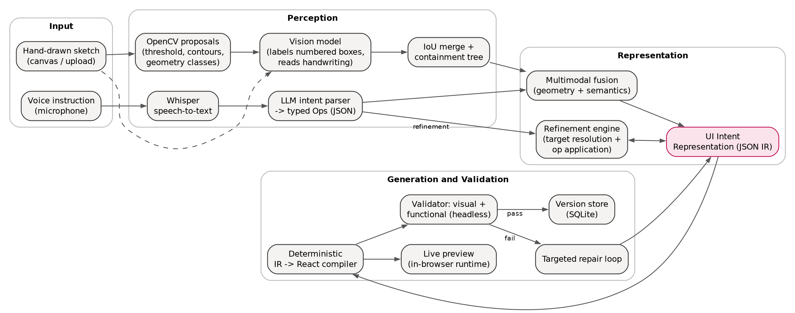

### 2.2 Component diagram

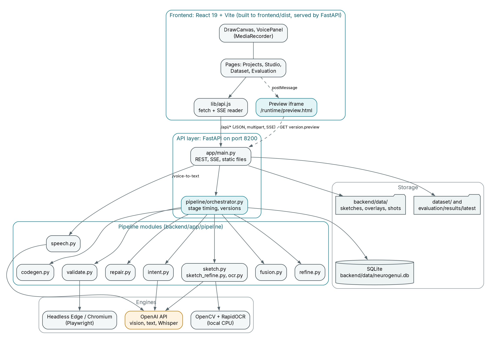

| Layer | Implementation | Responsibility |
|---|---|---|
| Frontend | React 19, Vite 8, Tailwind v4 in `frontend/`, built to `frontend/dist` | Canvas drawing, voice recording, running a generation, showing the IR, code, validation report and versions, dataset and evaluation pages |
| API | FastAPI app `backend/app/main.py` (uvicorn, port 8200) | REST endpoints, server-sent events (SSE), static files, serving the built frontend |
| Orchestration | `backend/app/pipeline/orchestrator.py` | Runs the stages in order, times them, forwards progress events, writes versions |
| Pipeline | `backend/app/pipeline/*.py` | The stage logic (Section 4) |
| Engines | OpenAI API; OpenCV and RapidOCR (local CPU); headless Microsoft Edge or Chromium through Playwright | Model calls, image processing, rendering for validation |
| Storage | SQLite file `backend/data/neurogenui.db`; files under `backend/data/{sketches,overlays,shots,audio}` | Projects, sketches, versions (Section 6) |

The browser preview and the validator use the same runtime page, `/runtime/preview.html`. The validator loads it in Playwright and serves it straight from disk through request interception, so validation works in-process without the API server being reachable.

### 2.3 Concurrency model

* Endpoints that run the pipeline are plain `def` functions, executed in FastAPI's thread pool.
* With `?stream=1` the pipeline runs in a worker thread that puts events on a queue; the response generator drains the queue and emits an SSE comment `: keep-alive` every 15 s of silence.
* Playwright's synchronous API is single-threaded, so `validate.py` keeps one browser alive on a dedicated worker thread (`ThreadPoolExecutor(max_workers=1)`). `validate()` can be called from any thread. The browser is warmed up in a background thread at server start.
* SQLite access goes through one re-entrant lock (`db.connect()`), with WAL journal mode.

## 3 End-to-end data flow

### 3.1 Generation flow

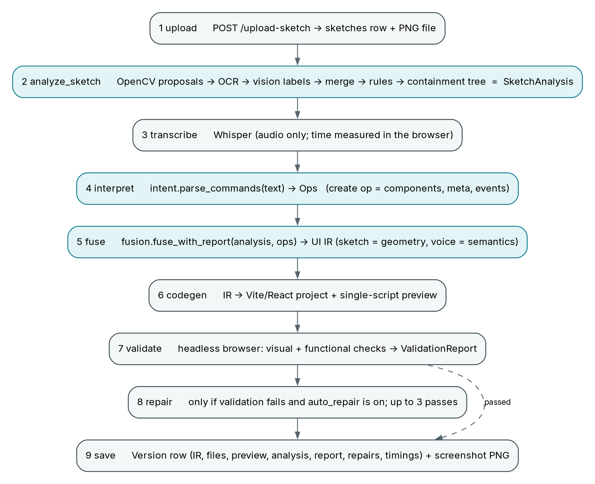

The stage names below are fixed identifiers; they appear as keys of `Version.timings` and as the `stage` field of SSE events.

1. **upload.** `POST /upload-sketch` decodes the image with OpenCV (transparent canvas exports are composited on white), stores it as `backend/data/sketches/<sketch_id>.png` and inserts a row in `sketches`.
2. **analyze_sketch.** `orchestrator.analyze()` runs `sketch.analyze_sketch(mode)` (modes `cv`, `vision`, `hybrid`), writes an overlay PNG (`overlays/<sketch_id>_<mode>.png`) and caches the analysis per mode in the `sketches.analysis` column. A repeated request for the same mode returns the cached result with `"cached": true`.
3. **transcribe.** If the user spoke, the browser first calls `POST /voice-to-text` (Whisper). The measured time is passed to `generate-ui` as `transcribe_ms` so that it appears in the timings; the stage itself is not run again.
4. **interpret.** `intent.parse_commands(text, None)` asks the text model for Ops. For a new screen the model returns a `create` op with the components, a title and a category, and any behaviour described in words (events).
5. **fuse.** `fusion.fuse_with_report(analysis, ops)` merges the sketch geometry and the spoken semantics into one IR (Section 4.4). Without a sketch, the IR is built from the voice description alone.
6. **codegen.** `codegen.generate_code(ir, version=n)` compiles the IR into a Vite and React project (`files`) and into a single script (`preview`) for the runtime.
7. **validate.** `validate.validate(...)` renders the preview in a headless browser and runs the visual and functional checks, producing a `ValidationReport` and a full-page screenshot.
8. **repair.** If validation failed and `auto_repair` is true (default), `repair.repair_loop` runs up to 3 passes of targeted fixes. If validation passed, the stage is skipped.
9. **save.** The `Version` (IR, files, preview, analysis, report, repairs, timings) is written to SQLite and the screenshot to `backend/data/shots/<project>_v<n>.png`.

If neither a sketch nor a description is provided, the call fails with HTTP 400 ("Provide a sketch, a description, or both"). A generation with only text builds the page from voice; a generation with only a sketch uses an empty list of Ops, so the IR contains only sketch-derived components with placeholder labels.

### 3.2 Refinement flow

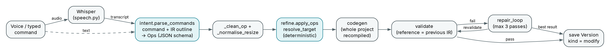

`orchestrator.run_modify(project_id, text, source, base_version, ...)` loads the base version (the latest if none is given) and then:

1. **interpret**: `intent.parse_commands(text, base_ir)`. The model sees a compact outline of the current IR (`intent.ir_summary`: one line per node with id, type, label, size hints and parent, plus notes on repeated types and shared labels) so that it can fill in node ids directly.
2. **fuse** (the stage name is reused): `refine.apply_ops(base_ir, ops)` applies the operations to a deep copy of the IR and returns the new IR and one change record per op (`ok` true or false with an error text). Ops can also be passed directly in the request (`ops`), in which case no model call is made.
3. **codegen**, **validate** and **repair** as in generation, with one difference: the base version's IR is passed as `reference`. The validator then reports any component that existed in the previous version and has disappeared (without the user removing it) as a failing check, and the repair loop restores it in the same place.
4. The result is saved as a new version with `kind: "modify"` and `parent` set to the base version.

Versions are never overwritten. `restore`, manual IR edits and manual code edits all create new versions (Section 6.3).

## 4 Module reference

### 4.1 Sketch processing (`sketch.py`, `sketch_refine.py`, `ocr.py`)

**Purpose.** Convert a hand-drawn wireframe into a list of typed, located components with a containment tree.

**Input.** Image bytes (PNG or JPG, at most 15 MB at upload) and a mode. **Output.** A SketchAnalysis dictionary:

```json
{
  "components": [
    {"type": "heading", "label": "Login", "bbox": {"x": 0.395, "y": 0.1864, "w": 0.17, "h": 0.0545},
     "confidence": 0.85, "source": "hybrid", "parent": 0, "shape": "text", "ocr": true}
  ],
  "width": 1000, "height": 1100, "mode": "hybrid", "title": "Nimbus Landing Page", "category": "landing",
  "timings": {"cv_ms": 96, "vision_ms": 7893, "total_ms": 8001},
  "cv_candidates": 32, "model": "gpt-4.1-mini-2025-04-14", "overlay_url": "/files/overlays/s_xxxxxxxx_hybrid.png"
}
```

(The `components` entry is shaped like the fixture `backend/tests/fixtures/login_sketch.json`; `width`/`height` of that fixture are 1000 by 1100 and the metadata (title, category, timings, `cv_candidates`, model) are those of the recorded real analysis `backend/tests/fixtures/land_01_hybrid.json`, a real hybrid run on dataset sketch `land_01`, which has 26 components.) Boxes are normalised to 0..1 of the sketch; `parent` is the index of the enclosing container component or `null`.

**Modes.**

| Mode | What runs | Needs a key |
|---|---|---|
| `cv` | OpenCV proposals and local OCR only; the type is a geometry-based guess (`_guess_type`) | no |
| `vision` | the vision model lists all components and boxes (second image has a 10 percent coordinate grid) | yes |
| `hybrid` (default) | OpenCV proposes, the vision model labels | yes |

#### 4.1.1 OpenCV proposals (`detect_cv`)

1. **Working size.** The image is scaled to 1000 px width (`WORK_WIDTH`).
2. **Ink mask** (`ink_mask`). The paper is flattened by dividing the grey image by a dilated (25 px ellipse) and Gaussian-blurred (sigma 20) background estimate, removing shadows and lighting gradients. A mean adaptive threshold (block 31, C 15) and, where Otsu's mask is sane (mean below 60), Otsu are combined, then a 2 by 2 opening removes specks.
3. **Closed outlines** (`_shapes_at`, run at close sizes 9 and 3). Contours are taken with `RETR_CCOMP`; enclosed holes become candidates. A hole is classified as `cross_box` (a rectangle split into at least three triangles by an X, image placeholder), `circle` (circularity above 0.78, aspect 0.75 to 1.33) or `rect` (rectangularity above 0.72). Rules reject letter loops (`o`, `e`, `a`), wide short loops between letters and slivers between touching outlines. The strong close joins gaps in large wobbly boxes; the light close keeps small checkboxes and radios open.
4. **Open rectangles** (`_open_rects`). Large sparse connected strokes with edge strokes on at least 3 sides are accepted as boxes (confidence 0.55).
5. **Text, lines, lists.** Outline strokes are removed (`_strokes_outside`), then remaining ink is grouped into words and lines (`_text_lines`: two words join if they share a baseline band and the gap is below 0.55 of text height, so menu items stay separate). Long thin strokes become `line` (straight) or `squiggle` (wavy placeholder text, `_straight` fits a line and checks the residual). Stacked lines with a leading bullet mark become one `list` (`_bullet_lists`).
6. **OCR merge** (`_merge_ocr`). RapidOCR text lines are attached to the text candidates; a line that holds several widely spaced words splits across several candidates; lines the strokes missed are added.
7. **De-duplication.** `_dedupe` drops candidates with IoU above 0.7, preferring outlines over text clusters (`SHAPE_PRIORITY`).
8. **Geometry guess** (`_guess_type`). For example: a square under 60 px is a `checkbox`; a wide bar near the top is a `navbar`; a rectangle containing other shapes is a `card`; a big empty frame is an `image`; a short wide rectangle with centred text or a filled interior is a `button`, otherwise an `input`.

Each candidate carries `shape`, `area`, `aspect`, `fill`, `conf` (0 to 1), `guess` and, when OCR is on, `text`.

#### 4.1.2 Local OCR (`ocr.py`)

Optional. RapidOCR on onnxruntime (CPU, about 15 MB of models inside the wheel), installed from `backend/requirements-ocr.txt`. It reads text lines with boxes. If the package is missing, fails to load, or `NGUI_OCR=0`, `read_lines()` returns `None` and everything runs as before (this is the designed degradation).

* The image is read at `NGUI_OCR_SCALE` (default 2.0) because recognisers drop spaces in small handwriting; the analysis note records 84 percent of multi-word labels with correct spaces at scale 2 against 60 percent at scale 1.
* A post-pass restores spaces from wide blank columns in the ink (`word_gaps`, `insert_spaces`; word gap threshold 0.3 of ink height, `NGUI_OCR_SPLIT=0` disables it) and joins fragments that split a known UI word (`tidy_spaces`, vocabulary `UI_WORDS`).

#### 4.1.3 Vision labelling (hybrid)

`_vision_label` sends two images (the sketch and a copy with the proposals drawn as red numbered boxes) and a text list with one line per box (shape, pixel size, position, the geometry guess and any OCR reading). The model answers with a strict JSON schema (`BOX_SCHEMA`): for each numbered box a `type` (one of the component types or `none` for noise), a `label` (transcribed handwriting), a `confidence`; a `missed` list of components no box covers (with boxes normalised to 0..1); a short `title` and a `category`. The system prompt contains a wireframe vocabulary (`LABEL_RULES`), for example: a checkbox or radio is one component including its option text; a box with an X, a picture or a chart is an `image`; in a top bar the first word is the brand and the rest are `nav_item`; short lines with bullets are one `list`.

#### 4.1.4 Hybrid merge

For each proposal the label decides the outcome:

* no label returned: keep the geometry guess with confidence `0.6 * conf`, source `cv`;
* `none` but OCR read real words (score at least 0.8) on a text shape: keep as `text`, source `hybrid`;
* otherwise the labelled type is used, unless `plausible()` rejects it for the drawn geometry (for example a wide box labelled `icon`), in which case the geometry guess is used; the label is the vision reading, replaced by the OCR text when the vision text is empty or less than 0.6 similar (difflib ratio) to a confident OCR reading; confidence is the mean of detector and model confidence, source `hybrid`;
* `missed` components are added (confidence 0.7, source `vision`) unless a box with IoU above 0.5 exists.

An optional second pass (`NGUI_SKETCH_VERIFY=1`, off by default) draws the result as `n:type` boxes and asks the model only for corrections (`retype`, `remove`, `missing`), applied by `apply_verification`.

#### 4.1.5 Refinement rules (`clean_components`, `sketch_refine.py`)

After the modes above, a shared rule set based on geometry and labels cleans the list. None of the rules reference a particular sketch.

| Rule (function) | Effect |
|---|---|
| `calibrate_boxes`, `stroke_center_rect` | Pads ink-tight text boxes to a line box (30 percent above, 12 percent below); pulls wobbly rectangles onto the median stroke position of each side |
| `drop_vision_echoes`, `drop_conflicting_overlaps`, `merge_duplicates`, `merge_prefix_fragments`, `merge_text_fragments` | Remove duplicates produced by two detectors and join fragments of one word or paragraph |
| `_merge_text_into_boxes` | Text inside a button, input, link box becomes its label |
| `recover_bar_brands` | If the whole bar text was put on a navbar, the words before the first menu item become a brand component |
| `attach_marker_labels` | A checkbox or radio and its option text are one component covering both |
| `radios_without_labels_are_icons`, `unlabeled_glyphs_are_icons`, `pictures_are_images`, `unify_sibling_cards` | Type corrections |
| `refine_structure` | `pictures_from_strokes`, `absorb_list_items`, `field_adornments` (chevron means `select`), `underlines_are_decoration` (underlined text is a `link`), `complete_fields` (missing field outlines rebuilt from captions), `retype_boxes` (navbar, header, sidebar, image, card), `retype_text` (brand, menu items, heading versus text by size: 40 px and above is a heading, below 30 px is text), `lonely_wide_squiggles_are_dividers` |
| `containment_tree` | Each component's `parent` is the smallest container whose box holds it (at least 85 percent of the area for CV boxes, 40 percent for vision-only boxes, which are then clamped inside) |

**Failure handling.** Unreadable image: `ValueError`, HTTP 400 (`upload-sketch` returns 415 "Upload a PNG or JPG image"). Missing key in `vision` or `hybrid`: `OpenAIUnavailable`, HTTP 503. OCR unavailable: silent fallback. A component without a model label keeps its geometry guess, so a model that skips a box does not drop it.

**Known quirk.** The analysis shows that `analysis.components[].type` can be `container`; fusion maps it to `card` (Section 4.4).

### 4.2 Speech processing (`speech.py`)

* `transcribe(audio_bytes, filename, language="en") -> {"text", "model", "duration_ms"}` calls the OpenAI audio transcription endpoint with `OPENAI_STT_MODEL` (default `whisper-1`).
* The browser records with `MediaRecorder` (WebM, or OGG or MP4 depending on browser support) and uploads it as `voice.<ext>`. Accepted extensions: `.webm .wav .mp3 .m4a .mp4 .mpeg .mpga .ogg .oga .flac`; other names are renamed to `.webm`.
* Limits: empty audio gives HTTP 400, over 25 MB gives HTTP 413. `duration_ms` is the transcription latency, not the audio length.
* Whisper is called only for audio. Typed text goes directly to `intent.py`.

### 4.3 Intent parsing and the typed ops list (`intent.py`)

**Purpose.** Convert a sentence into a list of structured edit operations. The model never writes code and never receives the sketch.

**Call.** `parse_commands(text, ir=None)` sends a long system prompt (the op vocabulary, targeting rules, resize wording, about twenty worked examples), the instruction, and either "there is no UI yet" or the current IR outline. The answer is constrained by a strict JSON schema (`SCHEMA`, built with `llm.obj` and `llm.nullable`; every key required, nulls allowed) at temperature 0 (omitted for `gpt-5*` and `o*` models, which accept only the default; `llm.chat_json` also retries without `temperature` if the API rejects it). The client has a 60 s timeout and 2 retries.

**Op kinds** (`OP_KINDS`):

| Op | Meaning | Key fields |
|---|---|---|
| `create` | Describe a whole screen | `components` (nested via `children`), `meta` {title, category}, optional `page` |
| `add` | One new component | `component`, `position` {relation, anchor} |
| `remove` | Delete a component or a page | `target` |
| `modify` | Change label, props or style | `target`, `changes` {label, props, style} |
| `style` | Visual change (colour, variant, weight, radius, alignment) | `target`, `changes.style` |
| `move` | Re-place a component | `target`, `position` |
| `resize` | Any change of size | `target`, `scale`, `axis`, or `changes.style.width` = `full`, or absolute pixels |
| `interaction` | Behaviour on an event | `target`, `event` {on, actions} |
| `navigation` | Click opens a page (created if missing) | `target`, `page.name` |

`position.relation` is one of `below, above, left_of, right_of, inside, first, last`. `axis` is `width`, `height` or `both`. Action types: `validate_required`, `validate_format`, `show_message`, `navigate`, `toggle_visibility`, `set_text` (Section 4.5.3).

**Op schema (as returned after cleaning; null fields removed):**

```json
{
  "op": "style",
  "target": {"ref": "login button", "id": "btn_login"},
  "changes": {"style": {"color": "blue"}},
  "confidence": 0.97
}
```

Real examples taken from the system prompt and from the recorded `land_01` run:

```json
{"op": "add", "component": {"type": "link", "label": "Forgot password?"},
 "position": {"relation": "below", "anchor": {"ref": "login button", "id": "btn_login"}}, "confidence": 0.95}

{"op": "interaction", "target": {"ref": "login button", "id": "btn_login"},
 "event": {"on": "click", "actions": [{"type": "validate_required", "targets": null, "message": "Please fill in all fields"}]},
 "confidence": 0.93}

{"op": "interaction", "target": {"ref": "Try free button"},
 "event": {"on": "click", "actions": [{"type": "navigate", "page": "Sign up"}]}, "confidence": 0.95}
```

**Post-processing in code (deterministic):**

* `_clean_op` strips nulls; drops a hallucinated `target.id` or `anchor.id` that does not exist in the IR so that `resolve_target` takes over; converts colour words in `changes.style` to hex (`refine.normalize_style`); turns an `interaction` consisting only of `navigate` actions into a `navigation` op (one canonical form).
* `_normalise_resize` makes every size change a `resize` op. The model chooses the target; the **magnitude comes from the words of the utterance** (`refine.parse_resize_phrase`), so "a bit bigger" is always 1.15 regardless of how the model rounds it. Factors: bigger 1.3, a bit 1.15, a lot 1.6, twice 2, half 0.5, "N percent" 1 plus N/100, "N times" N, "full width" or "edge to edge" is `width: "full"`; smaller 0.75, a bit smaller 0.87, much smaller 0.6.

**Failure handling.** Empty text returns an empty op list with no model call. Missing key: 503. OpenAI errors are mapped to HTTP 500 with `OpenAI error: ...` (500 rather than 502 because the frontend reads 502 as "backend unreachable"). An op whose target cannot be found is not dropped here; it is reported later as a failed change.

### 4.4 Fusion (`fusion.py`)

**Purpose.** Build the first IR from the sketch analysis (where things are) and the `create` op (what they are), deterministically.

`fuse_with_report(analysis, ops, title=None) -> (ir, changes)`:

1. **Voice and sketch prototypes.** Both are turned into "protos" (type, label, props, style, bbox, events, origin). A sketch `container` becomes a `card`. Sketch text written right above or left of a field, or right of a checkbox or radio, is absorbed as that field's label (`_absorb_labels`).
2. **Matching** (`_match`), global and in two passes: (a) anchors are pairs of near-identical labels (similarity at least 0.85, `SAME_LABEL`) with compatible types, anywhere on the page; (b) the remaining voice components are matched to sketch components in reading order within the window between anchors. Score = type affinity (1.0 same type, 0.6 compatible group from `refine.COMPATIBLE`, 0.4 both textual) plus 1.2 times label similarity plus 0.5 times order closeness; the minimum is 0.6. Spoken generic containers are never matched.
3. **Merge** (`_merge`). The sketch component keeps the geometry and any text written on the sketch. The voice side contributes type when compatible, label only if the drawing had no text, props (input type, placeholder, required) and events.
4. **Layout from geometry** (`_arrange`). Items are grouped into rows by vertical overlap (`_rows`, overlap above half the smaller height) and rows into columns when items overlap horizontally; a row becomes a container with `direction: row`, with `justify` inferred (`_row_justify`). Navbars and headers are rows unless drawn stacked (a sidebar). A `container` or `card` that holds fields and no nested boxes becomes a `form`.
5. **Unmatched voice components** are inserted after the component spoken before them. A voice component that is already drawn is not added twice (`_drawn_twin`).
6. **Events** are resolved from references to ids (`refine.resolve_actions`) once all nodes exist.
7. **Finalisation** (`finalize_content`). Empty labels get neutral placeholders (`Text`, `Heading`, `Button`, `Link`, `Menu item`, `Option`); lists without items get 2 to 6 default rows by drawn height; selects without options get `Option 1..3`; empty wrapper containers are removed unless drawn.
8. **Frame metadata** (`frame_meta`). The IR gets `meta.frame` with `kind` (`mobile` if width/height is below 0.8, else `desktop`), `page_width` (the content width times 1200 CSS px for desktop or 430 for mobile, clamped to 280..1200) and `scale` (CSS px per sketch px).
9. **Without a sketch.** The IR is built from voice only: the run of fields and buttons is wrapped in a form, and a form-like category (login, registration, contact, booking, settings, profile) gets a page width of 480.

Rule: **what is written on the sketch always wins over what is spoken.** The voice only fills components drawn without text.

### 4.5 UI Intent Representation (`ir.py`)

The IR (`"schema": "neurogenui.ir/1"`) is the single document that the compiler, validator, repair loop and editor all share. Pydantic models for documentation and validation are in `backend/app/schemas.py` (the API stores the IR as free-form JSON).

#### 4.5.1 Document

```jsonc
{
  "schema": "neurogenui.ir/1",
  "meta": {
    "title": "Login", "category": "login",
    "theme": {"primary": "#4f46e5", "radius": 10, "font": "Inter"},
    "frame": {"kind": "desktop", "sketch_width": 1000, "sketch_height": 1100,
              "content": {"x": 0.25, "y": 0.1364, "w": 0.5, "h": 0.6909}, "page_width": 600, "scale": 1.2},
    "moved": [], "free_layout": [], "removed_ids": [], "removed_sketch": [], "hidden_by_user": []
  },
  "pages": [{"id": "page_main", "name": "Main", "route": "/", "root": { /* Node, type "page" */ }}],
  "next_id": 8
}
```

`meta.moved` (ids the user placed; geometry and order checks leave them alone), `meta.free_layout` (ids the repair loop laid out without sketch offsets), `meta.removed_ids` and `meta.removed_sketch` (intentional removals, not defects) and `meta.hidden_by_user` are bookkeeping fields that make refinement and repair safe. They are not in `docs/contract.md`.

#### 4.5.2 Node

| Field | Type | Notes |
|---|---|---|
| `id` | string | Stable and unique: `<prefix>_<slug>[_n]` from the label, or `<prefix>_<counter>` for unlabelled nodes |
| `type` | enum | `page container card form header navbar nav_item heading text link button input textarea checkbox radio select image list divider icon` (20 types) |
| `label` | string | Visible text, `""` if none |
| `props` | object | Type-specific, allow-list `PROP_KEYS` (below) |
| `style` | object | Allow-list `STYLE_KEYS` (below) |
| `layout` | object | Containers only: `direction` column or row, `gap`, `align`, `justify` |
| `bbox` | object or null | `{x, y, w, h}` normalised to the sketch; null if not from a sketch |
| `children` | array | Containers only (`page container card form header navbar list`) |
| `relations` | array | `{type: below, above, left_of, right_of, inside, label_for; target: id}` |
| `events` | array | `{on: click, submit, change; actions: [...]}` |
| `origin` | enum | `sketch`, `voice`, `repair`, `manual` |

ID prefixes: `page`, `box` (container), `card`, `form`, `hdr`, `nav`, `navi`, `h`, `txt`, `lnk`, `btn`, `inp`, `ta`, `chk`, `rad`, `sel`, `img`, `list`, `div`, `ico`.

Allowed `props` per type: heading `level` (clamped 1..4); input `inputType` (`text email password tel number date search`), `placeholder`, `required`, `name`; textarea `placeholder rows required name`; checkbox and radio `checked`, `group`; select `options required name`; image `alt`, `photo` (one of `person product banner food travel building finance nature`, or empty); link, nav_item and button `href_page`; list `items`. Note that `docs/contract.md` lists fewer keys for textarea and select; the code (`ir.PROP_KEYS`) is authoritative.

Allowed `style` keys: `variant` (primary, secondary, outline, ghost, danger), `color`, `textColor`, `bg`, `size` (sm, md, lg), `width` (`auto`, `full` or an integer in px), `height` (px), `align` (left, center, right), `fontSize`, `fontWeight`, `radius`, `hidden`. Unknown keys are dropped by `clean_style` and `clean_props`.

#### 4.5.3 Actions

| Action | Fields | Run-time behaviour (`src/runtime/actions.js`) |
|---|---|---|
| `validate_required` | `targets` (field ids), `message` | If any target value is empty, mark the fields invalid, show the message with `role="alert"` and stop the chain |
| `validate_format` | `target`, `format` (`email`, `phone`, `number`), `message` | Regex test (`email`: `^[^\s@]+@[^\s@]+\.[^\s@]+$`; `phone`: 7 or more digits and separators; `number`); on failure show the message and stop |
| `show_message` | `text`, `tone` (success, error, info) | Show a message next to the owner; if a `navigate` follows, the message is carried to the new page as a toast (`ui.notice`) |
| `navigate` | `page` (page id) | Switch the current page in the UI store |
| `toggle_visibility` | `target` | Flip a node's hidden flag |
| `set_text` | `target`, `text` | Override a node's displayed text |

Actions run in order. `merge_event` keeps validations before effects. A `validate_required` with `targets: null` is expanded by `refine.field_scope` to all fields of the owner's form (or container, or the page).

#### 4.5.4 A real example

This is the real output of `fusion.fuse_with_report` on the test fixture `login_sketch.json` (a drawn card with two captioned fields, a checkbox, a button and a picture box) and a `create` op like the one the model returns for "Create a login page with email and password and a login button" plus the interaction "Show an error when login is clicked with empty fields". The IR below is shortened (bbox of every node except one removed, empty arrays removed); the full output was generated locally without any API call.

```json
{
  "schema": "neurogenui.ir/1",
  "meta": {"title": "Login", "category": "login",
           "theme": {"primary": "#4f46e5", "radius": 10, "font": "Inter"},
           "frame": {"kind": "desktop", "sketch_width": 1000, "sketch_height": 1100,
                     "content": {"x": 0.25, "y": 0.1364, "w": 0.5, "h": 0.6909}, "page_width": 600, "scale": 1.2}},
  "pages": [{"id": "page_main", "name": "Main", "route": "/", "root": {
    "id": "page_main", "type": "page", "label": "Main", "origin": "voice",
    "layout": {"direction": "column", "gap": 16, "align": "stretch", "justify": "start"},
    "children": [{
      "id": "form_1", "type": "form", "origin": "sketch",
      "layout": {"direction": "column", "gap": 12, "align": "stretch", "justify": "start"},
      "children": [
        {"id": "h_login", "type": "heading", "label": "Login", "props": {"level": 1}, "origin": "sketch"},
        {"id": "inp_email", "type": "input", "label": "Email",
         "props": {"inputType": "email", "placeholder": "you@example.com", "required": true},
         "relations": [{"type": "below", "target": "h_login"}], "origin": "sketch"},
        {"id": "inp_password", "type": "input", "label": "Password",
         "props": {"inputType": "password", "required": true},
         "relations": [{"type": "below", "target": "inp_email"}], "origin": "sketch"},
        {"id": "chk_5", "type": "checkbox", "label": "Option", "origin": "sketch"},
        {"id": "btn_login", "type": "button", "label": "Login", "origin": "sketch",
         "relations": [{"type": "below", "target": "chk_5"}],
         "events": [{"on": "click", "actions": [
           {"type": "validate_required", "targets": ["inp_email", "inp_password"], "message": "Please fill in all fields"}]}]},
        {"id": "img_7", "type": "image", "label": "", "origin": "sketch"}
      ]}]}}],
  "next_id": 8
}
```

Points worth noticing: the sketch card became a `form` because it holds fields; the text drawn above each field was absorbed as the field's label; the spoken input types, placeholder and `required` flags were merged onto the drawn fields; the `validate_required` action with `targets: null` was resolved to the two field ids; the drawn checkbox had no readable text and received the placeholder label `Option`.

### 4.6 Refinement (`refine.py`)

`apply_ops(ir, ops) -> {"ir", "changes"}` is **pure**: it deep-copies the input, applies the ops in order, and never raises for a bad op; each op produces one entry `{"op", "target", "detail", "ok", "error"?}`.

#### 4.6.1 `resolve_target(ir, ref, type_hint=None) -> {"id", "score"}`

Deterministic mapping of a spoken reference to a node id:

1. An exact node id (score 1.0), or a page name or id (score 0.9) resolves directly.
2. The reference is tokenised (`nav item`, `menu item` phrases are protected). The **last type word** (`button`, `field`, `link`, `image`, `logo`, `dropdown`, `menu`, ... from `TYPE_WORDS`) fixes the wanted type; ordinal words (`first second third fourth fifth last top bottom final`, `ORDINALS`) select by document order; other words are label words. `box` is only a hint towards fields. "password" or "email" alone means that input.
3. Every node is scored: type score 1.0 for equal, 0.6 for the same compatibility group (`COMPATIBLE`), 0 for others (those are excluded when a type is wanted); label score is the mean token match (exact, or difflib ratio at least 0.8) against label, id slug, `inputType`, `placeholder`, `name`, `alt`, `photo`. Combined `0.4 * type + 0.6 * label` when both are known.
4. Ties lower the score by 15 percent; scores below `RESOLVE_THRESHOLD = 0.35` return `id: null`. Ordinals pick the n-th of the best-scoring pool.

Real results on the example IR: `login button` gives `btn_login` (1.0); `the email field` gives `inp_email` (1.0); `second input` gives `inp_password` (0.8); `password` gives `inp_password` (1.0).

When the model supplies an id that contradicts the words of the reference (for example the id of the text "Email" for "the email field"), `_ref_type_conflict` rejects the id and the resolver is used instead.

#### 4.6.2 Operations

| Op | Behaviour |
|---|---|
| `add` | Builds the node (`irm.make_node`, input type guessed from the label), places it with `insert_relative`, records a spatial relation; without a position, `default_anchor` chooses (heading goes first; a field goes below the last field; a button below the last button; a nav item into the navbar; otherwise at the end of the page) |
| `remove` | Detaches the node and its subtree, drops relations and actions that referenced it, records `meta.removed_ids` (and `removed_sketch` for sketch-origin nodes) so validation does not flag an intentional removal; removing a non-main page is allowed, the main page is not |
| `modify`, `style` | Label, props (`null` removes a prop) and style changes; colour words become hex (`COLOR_WORDS`, 60 entries: `blue` gives `#2563eb`); a `style` with `color` on the page node sets `meta.theme.primary`; changing the colour of an outline, ghost or secondary button switches it to `primary`; if the model gave field-only props (placeholder, required, input type) for a text node that the user calls a field and no input matches, the text is promoted to an input (`_promote_label_to_field`) |
| `resize` | `scale` with `axis` multiplies the current extent: the explicit style value, else the size drawn on the sketch (`drawn_width`, `drawn_height`), else a per-type default (`DEFAULT_WIDTHS`, `DEFAULT_HEIGHTS`, `DEFAULT_FONTS`). Text scales its font size; buttons scale height and font; images, cards and inputs scale width and height; textareas scale `rows`. A width reaching 95 percent of the page becomes `full`. Scale is clamped to 0.2..4. A size word `sm/md/lg` is a step with factors 0.7, 1.0, 1.4 |
| `move` | Detaches the node and re-inserts it relative to an anchor; records the id in `meta.moved`; refuses to move a node relative to itself or its own subtree. A plural anchor ("below the time slots") means the edge of the whole option group (`_option_group_edge`) |
| `interaction` | Resolves action references (`resolve_actions`), merges them into the node's events; fields default to the `change` event, forms to `submit`, others to `click`; a `navigate` also sets `props.href_page` on clickable nodes |
| `navigation` | `ensure_page` finds or creates the page (heading, one text line, and a "Back" link to the first page), then adds a `navigate` action on click |
| `create` | Re-creates the screen by running fusion without a sketch, keeping the current theme |

`insert_relative` handles layout intent: "below" a node that sits in a row stacks the two in a new column container in the anchor's slot; "left of" or "right of" a node in a column wraps them in a new row.

#### 4.6.3 Preservation

Because edits are applied to the data structure and the code is a pure function of the IR, nodes that an op does not touch have the same ids, props, style and position in the next version. The evaluation measures this as "preservation" (Section 10): the share of non-target elements that keep type, text, colours, font size and size (plus or minus 15 percent) after a command.

Real example (applied locally to the IR of Section 4.5.4, no model call):

```json
[
  {"op": "style",  "target": "btn_login", "detail": "style={'color': '#2563eb'}", "ok": true},
  {"op": "add",    "target": "lnk_forgot_password", "detail": "added link 'Forgot password?' below btn_login", "ok": true},
  {"op": "remove", "target": null, "detail": "", "ok": false, "error": "target 'the ghost thing' not found"},
  {"op": "resize", "target": "btn_login", "detail": "style={'width': 'full', 'height': 100, 'fontSize': 20, 'size': 'lg'}", "ok": true}
]
```

A failed op does not abort the others; the failure is shown in the Studio and counts against the change in the version summary (`changes_ok` of `changes`).

### 4.7 Code generation (`codegen.py`)

**Purpose.** A deterministic compiler from IR to a runnable React project. `generate_code(ir, safe_ids=None, version=None) -> {"files", "preview", "stats"}`.

**Output files** (real list for the login example; the set of component files depends on the types used):

```
package.json  index.html  vite.config.js  README.md
src/main.jsx  src/App.jsx  src/styles.css
src/runtime/store.js  src/runtime/actions.js
src/components/{Stack,Page,Form,Heading,Field,Checkbox,Button,Image,Message}.jsx
src/pages/MainPage.jsx
```

For that example `stats` is `{"files": 19, "components": 9, "pages": 1, "loc": 705, "preview_bytes": 17046}`.

**Reusable components.** One component per IR type (`COMPONENT_FOR`): `Stack` (shared flex container), `Page`, `Container`, `Card`, `Form`, `Header`, `Navbar`, `List`, `NavItem`, `Heading`, `Text`, `Link`, `Button`, `Field` (input), `TextArea`, `Select`, `Checkbox`, `Radio`, `Image`, `Divider`, `Icon`, plus `Message` for action feedback. Only the components used are emitted (`_component_closure`). Every rendered node carries `data-ngid="<id>"` and `data-ngtype="<type>"` (through `useNode`), which is how validation and the preview highlight find it.

**Pages and state router.** Each IR page becomes a page component (`src/pages/<Name>Page.jsx`). `App.jsx` holds `PAGES = {page_id: Component}` and a UI store (`useUIStore` in `src/runtime/store.js`, plain `useState`, no router library) with: current page, field values, messages, invalid flags, hidden flags, text overrides and a notice. `navigate(pageId, carry)` switches the page and clears messages.

**Events.** An event compiles to a constant holding the action list and a handler, for example:

```jsx
const BTN_LOGIN_CLICK = [ { "type": "validate_required", "targets": ["inp_email", "inp_password"],
                            "message": "Please fill in all fields" } ];
...
const handleBtnLoginClick = () => runActions("btn_login", BTN_LOGIN_CLICK, ui);
...
<Button id="btn_login" label="Login" style={{ width: "80%", marginLeft: "10%", ... }} onClick={handleBtnLoginClick} />
<Message owner="btn_login" />
```

`runActions` lives in `src/runtime/actions.js` (Section 4.5.3).

**Style mapping** (`node_style`). IR style keys become inline styles; `variant` and `size` become component props. A button `color` is its fill (outline and ghost buttons use it as text colour); containers use it as border colour; other nodes as text colour. `width: "full"` becomes `100%`; an integer width becomes `width` with `maxWidth: 100%` (a page uses `maxWidth`). The theme (`meta.theme`: primary colour, radius, font) is written into `src/styles.css` through CSS variables; the primary colour is validated against a safe pattern before insertion.

**Geometry-aware layout** (class `Geometry`). When nodes carry boxes and `meta.frame` exists, the compiler positions each child inside its parent's drawn frame so the result looks like the drawing and still reflows:

* widths as percentages of the parent frame (`_pct`), left offsets as percentage margins, clamped so a child near the right edge cannot overflow its parent;
* vertical gaps in px from the drawn distance times `frame.scale`, clamped to 0..160 px (0..80 inside rows);
* heights from the drawn box: images 40..600 px, buttons 32..64 px, heading font size from height (0.62 times, clamped 16..44), small controls get a drawn `minHeight`, icons are capped at 38 px, dividers use padding to reproduce the drawn band;
* one-line rows (a menu, a button bar) are centred vertically (`line_row`).

Nodes in `meta.moved` or `meta.free_layout`, and nodes in `safe_ids`, are laid out without geometry (natural flow). User styles always win over drawn values.

**Two forms of the output.** `files` is the exportable Vite project (`package.json` pins React 18.3.1, Vite and `@vitejs/plugin-react`). `preview` is the same code concatenated with module syntax stripped (`_to_script`) so it can run on the runtime's React globals, ending with `ReactDOM.createRoot(document.getElementById("root")).render(<App />)`.

**Safe mode.** `safe_ids` (used by the repair loop) makes the compiler emit the listed nodes without inline styles, geometry or handlers.

**Determinism.** No random or time-dependent values are used; the same IR yields the same code. A test (`backend/tests/test_codegen.py`) covers compilation.

### 4.8 Live preview runtime (`backend/app/static/runtime/`)

`preview.html` (served at `/runtime/preview.html`) loads vendored React 18.3.1, ReactDOM and `@babel/standalone` (`vendor/*.min.js`), `runtime.css` (error box and highlight outline) and a photo library `photos/{person,product,banner,food,travel,building,finance,nature}.jpg`.

* **Code in.** Either `?project=<id>&version=<n>` (it fetches `/api/projects/<id>/versions/<n>` and runs `preview`) or `window.postMessage({type: "ngui:code", code})` from the parent. The code is transpiled with the React preset and run with `new Function("React", "ReactDOM", compiled)`.
* **Messages out** (to the parent): `{type: "ngui:ready"}`, `{type: "ngui:error", message, stack}`, `{type: "ngui:rendered", nodes: [{id, type, rect}]}`. **In:** `{type: "ngui:highlight", id}` outlines a node (used when hovering the IR tree).
* **Test hook.** `window.__ngui = {run(code), errors(), nodes(), highlight(id)}`. `run` unmounts earlier React roots (it wraps `ReactDOM.createRoot` to track them), clears injected styles and errors, transpiles and renders, waits two animation frames and 20 ms, and resolves `{ok, errors, nodes}`. Compile and runtime errors are shown in a red box and recorded; `console.error` calls are recorded too but flagged `console: true` and do not count as hard failures.

### 4.9 Validation (`validate.py`)

**Purpose.** Prove in a real browser that what was generated renders, looks like the sketch, and behaves as the IR says.

`validate(ir, preview_code, analysis=None, reference=None) -> ValidationReport`. A browser is launched once (viewport 1280 by 800) and the runtime page is loaded through request interception on a fake origin `http://ngui.local`, serving `/runtime/*` from disk. Browser choice (`_channel_order`): Microsoft Edge first on Windows, bundled Chromium first elsewhere, the other as fallback; `NGUI_BROWSER=msedge|chromium` forces the first choice. If the page or browser dies, it is rebuilt once and the call retried.

**Check list.** Each check is `{"id", "kind": "visual"|"functional", "name", "ok", "detail", "target"?, "hard"}`. Hard checks decide `passed`; soft checks are reported only.

| Check id | Kind | Hard | What is asserted |
|---|---|---|---|
| `runtime:render` | functional | yes | The code transpiles and renders at least one node with no uncaught error |
| `presence:<id>` | visual | yes | The node is in the DOM, visible (non-zero box, not `display:none`, visibility, opacity), inside the page width; text-bearing nodes render text. A node hidden by design is accepted; a node hidden although drawn in the sketch fails. Extra pages are rendered by setting the initial page |
| `size:<id>` | visual | yes | No explicit non-positive width or height, and not collapsed below 4 by 4 px |
| `order:<id>` | visual | yes | Visible children appear in IR order along the container's direction |
| `sketch_order:<id>` | visual | yes | Children with boxes (not user-moved) keep the sketch's vertical order in column containers |
| `layout:<id>` | visual | no | Per-node IoU against the sketch after normalising both to their content box (flagged below 0.1) |
| `layout:overall` | visual | no | Mean IoU over sketched leaves at least 0.25, plus pairwise vertical-order consistency |
| `coverage:<n>` | visual | yes | Every analysed sketch component (except empty text) is represented by an IR node with IoU above 0.5, or was removed on purpose, or is a field label absorbed into a control |
| `missing:<id>`, `snapshot_hidden:<id>` | visual | yes | With a `reference` IR: a node of the previous version vanished without a removal, or got hidden |
| `clickable:<id>` | functional | yes | Buttons, links and nav items: the centre point hit-test returns the element itself (reports `covered by <tag>`) |
| `typing:<id>` | functional | yes | Inputs and textareas accept sample text (`test.user@example.com`, `Secret123!`, `5551234567`, `42`, `2026-01-15`, ...) and read it back; selects can select the first option; checkboxes and radios can be checked |
| `event:<id>:<on>` | functional | yes | Each event is simulated and its effect asserted: empty required fields show an `alert`-role message and do not navigate; with valid values the message or navigation appears; `toggle_visibility` flips visibility; `set_text` changes text; no runtime error during the interaction |

**Score** (0..1, informational): `0.25 * presence + 0.10 * order_consistency + 0.10 * layout_iou + 0.20 * no_runtime_errors + 0.15 * basic_functional_ratio + 0.20 * interaction_ratio`.

**Report shape** (real output for the example UI, 18 checks):

```json
{"passed": true, "score": 0.951,
 "visual": {"presence": 1.0, "layout_iou": 0.5101, "order_consistency": 1.0},
 "functional": {"runtime_errors": [], "interactions_total": 1, "interactions_passed": 1, "basic_ratio": 1.0},
 "browser": "chromium", "duration_ms": 2212,
 "checks": [
   {"id": "runtime:render", "kind": "functional", "name": "renders without runtime errors", "ok": true, "detail": "8 components rendered", "hard": true},
   {"id": "event:btn_login:click", "kind": "functional", "name": "click behaviour works", "ok": true,
    "detail": "empty fields -> error shown; valid input -> no error", "hard": true, "target": "btn_login"}]}
```

The stored report also contains `dom` (id, type, rect of each node). The screenshot is stored as a PNG and exposed as `validation.screenshot_url`. Validation time on this machine was about 0.5 s for a typical UI once the browser is warm (the 2.2 s above includes the first page load).

### 4.10 Repair loop (`repair.py`)

`repair_loop(ir, analysis=None, max_iter=3, code=None, report=None, manual_code=False, reference=None)`:

1. Take the failing **hard** checks, ordered by priority (`missing`, `snapshot_hidden`, `presence` first, then `size`, `coverage`, then the rest).
2. For each, apply one targeted fix to the IR (table below).
3. Recompile (`generate_code(ir, safe_ids)`), revalidate, and mark each applied fix `fixed` or `still failing`.
4. If a check is still failing after its targeted fix, **escalate** (at most two steps per check): first `relayout` of the surrounding groups (three ancestor levels), then `relayout_page` (the whole page without sketch offsets).
5. Stop when all hard checks pass, when no fix applies, or after `max_iter` passes.

Every fix is logged as `{"iteration", "check", "target", "action", "detail", "result"}` and stored in `Version.repairs`.

| Failing check | Action name | What it does |
|---|---|---|
| `missing:<id>` | `restore_from_snapshot` | Re-insert the node from the reference IR in the same parent, after the same sibling |
| `snapshot_hidden`, `presence` (hidden although drawn) | `unhide` | Remove the `hidden` style |
| `size:<id>` | `reset_size` | Drop the width and height that collapsed it |
| `coverage:<n>` | `unhide` or `reinsert_from_sketch` | Unhide a hidden node drawn there; else re-create the component from the analysis at the right parent and slot (a checkbox whose caption was a separate text gets that caption) |
| `sketch_order:<id>` | `reorder_siblings` | Stable sort by sketch y |
| `order:<id>` | `reset_layout` | Render that container in safe mode |
| `presence` (missing from DOM) | `recompile_safe` | Compile that node without styles and handlers |
| `presence` (invisible, empty) | `fill_placeholder`, `default_items`, `remove_empty_wrapper`, `give_height`, `reset_style` | Give text a placeholder, a list default rows, drop an empty wrapper or give a drawn empty box its sketch height, else reset style |
| `clickable`, `typing`, `event` with `covered:` | `relayout` | Lay the sibling group out naturally |
| `clickable` | `reset_style` | Remove style keys that can hide or shrink |
| `typing` | `recompile_safe` | Recompile the field in safe mode |
| `event` | `default_options` or `rebuild_handler` | A required dropdown without options gets options; else rebuild the event from valid references |
| `runtime:render` | `recompile` | Replace hand-edited code by compiled code; else sanitise the IR; else recompile every node in safe mode |

**Failure handling.** The loop never raises for a failed fix; it returns the best state it reached together with the report. Soft checks (layout IoU) are never repaired. The loop cannot repair what the validator cannot detect: a deleted node that has no sketch component and no reference snapshot is undetectable (Section 10).

## 5 REST API reference

Base URL `http://localhost:8200`. The seven endpoints from the original specification are mounted both at the root and under `/api` with the same handlers; the frontend uses `/api/...`. Interactive documentation is generated by FastAPI at `/docs` (OpenAPI at `/openapi.json`). All JSON is UTF-8. CORS allows the origins `http://localhost:5200`, `http://127.0.0.1:5200`, `http://localhost:8200`, `http://127.0.0.1:8200`.

### 5.1 Endpoint summary

| Method | Path | Purpose |
|---|---|---|
| POST | `/upload-sketch`, `/api/upload-sketch` | Store a sketch image |
| POST | `/analyze-sketch`, `/api/analyze-sketch` | Sketch to components |
| POST | `/voice-to-text`, `/api/voice-to-text` | Audio to text (Whisper) |
| POST | `/generate-ui`, `/api/generate-ui` | Sketch and/or text to a new version (optionally streamed) |
| POST | `/modify-ui`, `/api/modify-ui` | Command to a new version (optionally streamed) |
| POST | `/validate-ui`, `/api/validate-ui` | Validate (and optionally repair) a version |
| GET | `/project/{id}`, `/api/project/{id}`, `/api/projects/{id}` | Project with versions and latest version |
| GET | `/api/health` | Status, models, browser |
| GET, POST | `/api/projects` | List, create |
| DELETE | `/api/projects/{id}` | Delete (cascades to sketches and versions) |
| POST | `/api/interpret` | Preview how a command is understood |
| GET | `/api/projects/{id}/versions` | Version summaries |
| GET | `/api/projects/{id}/versions/{n}` | One full version |
| POST | `/api/projects/{id}/versions/{n}/restore` | Copy an old version forward |
| PATCH | `/api/projects/{id}/ir` | Save an edited IR as a new version |
| PUT | `/api/projects/{id}/code` | Save edited code as a new version |
| GET | `/api/projects/{id}/versions/{n}/export.zip` | Download a runnable Vite project |
| GET | `/api/samples` | Sample sketches from the dataset |
| GET | `/api/dataset` | Dataset sketches and commands |
| GET | `/api/eval` | Evaluation summary and plot URLs |

Static files: `/runtime/*` (preview runtime), `/files/sketches/*`, `/files/overlays/*`, `/files/shots/*` (stored data), `/files/dataset/*` (the `dataset/` folder) and `/files/eval/*` (`evaluation/results/latest`). Every other non-API path serves `frontend/dist/index.html` (client-side routes). If `frontend/dist` has not been built, `/` returns a small JSON note.

### 5.2 Errors

| Status | When |
|---|---|
| 400 | Empty upload or audio; empty command; `ValueError` from the pipeline (for example an unreadable image) |
| 404 | Unknown project, sketch or version; `/api/eval` without results |
| 413 | Sketch over 15 MB; audio over 25 MB |
| 415 | Upload is not a decodable PNG or JPG |
| 422 | Request body fails validation; IR without pages |
| 503 | `{"detail": "OPENAI_API_KEY not configured"}` |
| 500 | `{"detail": "OpenAI error: ..."}` or an unexpected pipeline error |

### 5.3 Endpoints in detail

**GET `/api/health`**

```json
{"ok": true, "openai_configured": true,
 "models": {"text": "gpt-4.1-mini", "vision": "gpt-4.1-mini", "stt": "whisper-1"},
 "browser": "chromium"}
```

`browser` is `msedge`, `chromium` or `none`. The key itself is never returned.

**POST `/api/upload-sketch`** (multipart: `file`, optional `project_id`). Without `project_id` a project is created, named from the file name.

```json
{"sketch_id": "s_1a2b3c4d", "project_id": "p_9f8e7d6c", "url": "/files/sketches/s_1a2b3c4d.png", "width": 1000, "height": 560}
```

IDs are `<prefix>_<8 hex>` (`db.new_id`).

**POST `/api/analyze-sketch`**

```json
{"sketch_id": "s_1a2b3c4d", "mode": "hybrid"}
```

Returns the SketchAnalysis of Section 4.1 plus `overlay_url`, `sketch_id` and, when cached, `"cached": true`. `mode` is `cv`, `vision` or `hybrid` (default).

**POST `/api/voice-to-text`** (multipart `file`)

```json
{"text": "Make the login button blue.", "model": "whisper-1", "duration_ms": 1180}
```

**POST `/api/interpret`**

```json
{"text": "Add a forgot password link below the login button", "project_id": "p_9f8e7d6c", "version": 3}
```

`version` is optional (latest if omitted); without `project_id` the text is read as a new screen. Response: `{"ops": [...], "latency_ms": 2050, "model": "gpt-4.1-mini"}`. No version is created.

**POST `/api/generate-ui`** (query `stream=1` optional)

```json
{"project_id": "p_9f8e7d6c", "sketch_id": "s_1a2b3c4d",
 "text": "Create a login page with email and password fields and a login button.",
 "source": "text", "mode": "hybrid", "auto_repair": true, "transcribe_ms": null}
```

`project_id` and `sketch_id` are optional (the project is derived from the sketch, or a new "Untitled project" is created). `source` is `voice` or `text`. Returns a Version (Section 6.3).

**POST `/api/modify-ui`** (query `stream=1` optional)

```json
{"project_id": "p_9f8e7d6c", "text": "make the login button blue", "source": "voice",
 "base_version": 2, "auto_repair": true, "transcribe_ms": 1180, "ops": null}
```

`base_version` defaults to the latest; `ops` bypasses the model (ops are then applied directly). A project without a version returns 404 "no version to modify; generate a UI first".

**POST `/api/validate-ui`**

```json
{"project_id": "p_9f8e7d6c", "version": 3, "repair": false}
```

Returns the ValidationReport (screenshot stored and referenced as `screenshot_url`) with `"repairs": []`. With `"repair": true` and a failing report, the repair loop runs and, if it changed anything, a new version of kind `repair` is saved and returned as `new_version`.

**GET `/api/project/{id}`** (values illustrative)

```json
{"id": "p_9f8e7d6c", "name": "Login", "created_at": "...", "updated_at": "...",
 "versions": [{"number": 1, "kind": "generate", "passed": true, "score": 0.95, "changes": 0, "repairs": 0, "total_ms": 12000, "...": "..."}],
 "version_count": 3, "latest_version": 3, "latest": { "...full Version...": "" },
 "thumbnail_url": "/files/shots/p_9f8e7d6c_v3.png", "sketch_url": "/files/sketches/s_1a2b3c4d.png",
 "sketch_id": "s_1a2b3c4d", "sketch": { "...sketch row...": "" }}
```

Note that here `versions` is a list of summaries, whereas in `GET /api/projects` the same key is a count.

**GET `/api/projects`** returns an array of project summaries (`id, name, created_at, updated_at, versions (count), latest_version, thumbnail_url, sketch_url, sketch_id`). **POST `/api/projects`** takes `{"name": "..."}`. **DELETE `/api/projects/{id}`** returns `{"ok": true}`.

**GET `/api/projects/{id}/versions`** returns version summaries (`number, parent, kind, text, source, created_at, passed, score, screenshot_url, changes, changes_ok, repairs, ir_synced, total_ms`). **GET `.../versions/{n}`** returns the full Version.

**POST `.../versions/{n}/restore`** creates a new version of kind `restore` that copies version `n`'s IR, files and validation, with `parent` set to the latest version.

**PATCH `/api/projects/{id}/ir`**: `{"ir": {...}, "base_version": 3}`. The IR must contain at least one page (422 otherwise). It is recompiled, validated (no automatic repair) and saved as kind `manual_ir`.

**PUT `/api/projects/{id}/code`**: `{"files": {"src/pages/MainPage.jsx": "..."}, "preview": "...", "base_version": 3}`. The new `preview` is validated against the base IR; files are merged over the base files; saved as kind `manual_code` with `ir_synced: false` (the IR no longer describes the code).

**GET `.../versions/{n}/export.zip`**: a folder `<title-slug>-v<n>/` containing every file of the version, `public/photos/<key>.jpg` for each photo used, and `neurogenui-ir.json`. Run it with `npm install && npm run dev`.

**GET `/api/samples`**: `[{"id": "login_01", "category": "login", "url": "/files/dataset/sketches/login_01.png", "title": "Login", "instruction": "Create a login page with email and password fields and a login button."}]`.

**GET `/api/dataset`**: `{"sketches": [{id, category, url, labels_url, n_components, instruction}], "commands": [{id, category, text, sketch_id, expected, audio_url}]}`.

**GET `/api/eval`**: the contents of `evaluation/results/latest/summary.json` plus a `plots` list of `/files/eval/...` URLs (404 if no results exist).

### 5.4 Streaming (SSE)

`POST /generate-ui?stream=1` and `POST /modify-ui?stream=1` return `Content-Type: text/event-stream` (`Cache-Control: no-cache`, `X-Accel-Buffering: no`). Each message is `data: <json>\n\n`. The browser client uses `fetch` with a `ReadableStream` (EventSource cannot send a POST body).

```
data: {"event": "stage", "stage": "analyze_sketch", "status": "start", "ms": 0, "data": {}}
data: {"event": "stage", "stage": "analyze_sketch", "status": "done", "ms": 8001, "data": {"components": 26, "mode": "hybrid", "overlay_url": "/files/overlays/s_1a2b3c4d_hybrid.png", "cached": false}}
data: {"event": "stage", "stage": "interpret", "status": "done", "ms": 5114, "data": {"ops": 3, "model": "gpt-4.1-mini"}}
data: {"event": "stage", "stage": "fuse", "status": "done", "ms": 3, "data": {"nodes": 31, "pages": 1}}
data: {"event": "stage", "stage": "codegen", "status": "done", "ms": 1, "data": {"files": 19, "components": 9, "loc": 705}}
data: {"event": "stage", "stage": "validate", "status": "done", "ms": 517, "data": {"passed": true, "score": 0.95}}
data: {"event": "result", "version": { ... full Version ... }}
```

| Event | Fields |
|---|---|
| `stage` | `stage` (`upload`, `analyze_sketch`, `interpret`, `fuse`, `codegen`, `validate`, `repair`, `save`), `status` (`start`, `done`, `error`), `ms`, `data` (small summary; `error` carries `detail`, truncated to 300 characters) |
| `result` | `version`: the saved Version |
| `error` | `detail`, `status` (HTTP-equivalent: 404, 400, 503, 500) |

The `transcribe` stage is not streamed (it ran earlier in the browser); stages that did not run (`repair` when validation passed) produce no events and show 0 ms in `timings`. A line `: keep-alive` is sent after 15 s of silence. (The `data` values and millisecond figures above are illustrative of the message shape, not a captured request; the 8001 ms analysis time is from the recorded `land_01` run.)

## 6 Data model and storage

### 6.1 SQLite (`backend/data/neurogenui.db`, `db.py`)

Created at start (`db.init()`), `PRAGMA journal_mode = WAL`, `foreign_keys = ON`.

```sql
CREATE TABLE projects (id TEXT PRIMARY KEY, name TEXT NOT NULL, created_at TEXT NOT NULL, updated_at TEXT NOT NULL);
CREATE TABLE sketches (id TEXT PRIMARY KEY,
  project_id TEXT NOT NULL REFERENCES projects(id) ON DELETE CASCADE,
  filename TEXT NOT NULL, width INTEGER, height INTEGER,
  analysis TEXT,            -- JSON {mode: SketchAnalysis}, cached per mode
  created_at TEXT NOT NULL);
CREATE TABLE versions (
  project_id TEXT NOT NULL REFERENCES projects(id) ON DELETE CASCADE,
  number INTEGER NOT NULL, parent INTEGER, kind TEXT NOT NULL,
  data TEXT NOT NULL,       -- the full Version as JSON
  created_at TEXT NOT NULL,
  PRIMARY KEY (project_id, number));
```

Timestamps are UTC ISO-8601 with second precision. Version numbers are assigned as `MAX(number) + 1` per project. The `data` column holds the complete Version document, so a version is self-contained and can be read, compared and exported without joins.

### 6.2 Files

| Location | Content |
|---|---|
| `backend/data/sketches/<sketch_id>.png` | Uploaded sketch, re-encoded as PNG |
| `backend/data/overlays/<sketch_id>_<mode>.png` | Detection overlay (boxes, type and label tags) |
| `backend/data/shots/<project_id>_v<n>.png` | Full-page validation screenshot |
| `backend/data/audio/` | Created at start; nothing in the current code writes to it |

The data directory can be moved with the environment variable `NGUI_DATA_DIR`. In Docker it is the volume `neurogenui-data` mounted at `/app/backend/data`.

### 6.3 Version document

```jsonc
{
  "project_id": "p_9f8e7d6c", "number": 3, "parent": 2,
  "kind": "generate | modify | repair | manual_ir | manual_code | restore",
  "text": "make the login button blue", "source": "voice | text",
  "ops": [ /* Op */ ], "changes": [ /* {op, target, detail, ok, error?} */ ],
  "ir": { /* IR */ }, "ir_synced": true,
  "files": { "src/App.jsx": "..." }, "preview": "...", "code_stats": {"files": 19, "components": 9, "pages": 1, "loc": 705, "preview_bytes": 17046},
  "sketch_id": "s_1a2b3c4d", "analysis": { /* SketchAnalysis or null */ },
  "validation": { /* ValidationReport, with screenshot_url instead of the base64 screenshot */ },
  "repairs": [ /* {iteration, check, target, action, detail, result} */ ],
  "interpret": {"model": "gpt-4.1-mini", "latency_ms": 2050},
  "timings": {"upload": 0, "analyze_sketch": 0, "transcribe": 0, "interpret": 2050, "fuse": 1, "codegen": 1, "validate": 543, "repair": 0, "save": 15, "total": 2610},
  "created_at": "2026-11-07T10:15:02+00:00"
}
```

The `timings` shown are those of the screenshot in Section 7 (the 2.61 s refinement). `parent` is the previous latest version for generate, the base version for modify and repair, and the latest version for restore. A new generation in an existing project becomes the next version of that project (parent = latest). `ir_synced` is false after a manual code edit and tells the repair loop and the UI that the IR no longer matches the code.

## 7 Frontend

Source: `frontend/src` (React 19, React Router 7, Vite 8, Tailwind CSS v4, `motion`, `recharts`, `lucide-react`, `sonner`, CodeMirror 6). In production the build output `frontend/dist` is served by FastAPI at `/` (same origin, no CORS needed). In development the Vite server on port 5200 proxies `/api`, `/runtime`, `/files` and the seven core endpoints to port 8200.

### 7.1 Pages and routes

| Route | File | Content |
|---|---|---|
| `/` | `pages/Projects.jsx` | Project list with thumbnails, creation, sample sketches as quick-picks |
| `/p/:id` | `pages/studio/Studio.jsx` and siblings | The Studio (below) |
| `/dataset` | `pages/Dataset.jsx` | The 40 sketches with labels and the 80 commands with audio |
| `/evaluation` | `pages/Evaluation.jsx`, `components/Charts.jsx` | Metric cards with baseline comparison and charts from `/api/eval` |
| `*` | `App.jsx` | Not-found page |

The Studio and the dataset and evaluation pages lazy-load. (The marketing sections of the landing area, `pages/home/*`, are being redesigned and are not documented here.)

### 7.2 The Studio

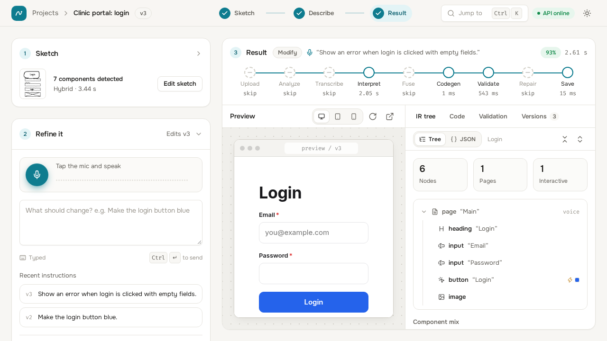

The Studio is a three-step flow shown in the top bar as Sketch, Describe, Result.

1. **Sketch** (`SketchPanel.jsx`, `DrawCanvas.jsx`). A pointer-event canvas (mouse, pen, touch) with pen and eraser (keys `P`, `E`), undo and redo (Ctrl+Z, Ctrl+Shift+Z or Ctrl+Y) over immutable stroke snapshots, a grid, selectable aspect ratio, image upload, and a sample picker (`/api/samples`). A mode selector chooses Hybrid, OpenCV only (no key needed) or Vision model only. "Analyze" uploads the canvas as a PNG and calls `analyze-sketch`; a scan overlay (`ScanOverlay.jsx`) shows detected boxes.
2. **Describe / Refine** (`VoicePanel.jsx`). Microphone button (`getUserMedia`, `MediaRecorder`) or a text box (Ctrl+Enter sends); recent instructions; example prompts; an auto-repair switch. For a project without a version the instruction becomes `generate-ui`; afterwards each instruction is a `modify-ui` against the current version.
3. **Result.** `PipelineTrace.jsx` shows the nine stages (Upload, Analyze, Transcribe, Interpret, Fuse, Codegen, Validate, Repair, Save) with live status and time from the SSE events, the parsed ops, and the validation score. `Preview.jsx` embeds `/runtime/preview.html` in an iframe (desktop, tablet 820 by 1180, and mobile frames) and sends code with `postMessage`.

Inspector tabs on the right:

| Tab | File | What it does |
|---|---|---|
| IR tree | `IrTab.jsx` | Tree and JSON views, node properties editor (label, variant, colours, size, align...), component mix; hovering a node highlights it in the preview; "Save as version" calls `PATCH /api/projects/{id}/ir` |
| Code | `CodeTab.jsx` | CodeMirror editor for every generated file, live re-run in the preview, "save" calls `PUT .../code`, download link to `export.zip` |
| Validation | `ValidationTab.jsx` | Score ring, presence, layout IoU and order bars, interaction counts, filterable list of all checks; buttons "Validate" and "Validate + repair" |
| Versions | `VersionsTab.jsx` | Timeline of versions with kind, instruction, score, restore, and a compare dialog |

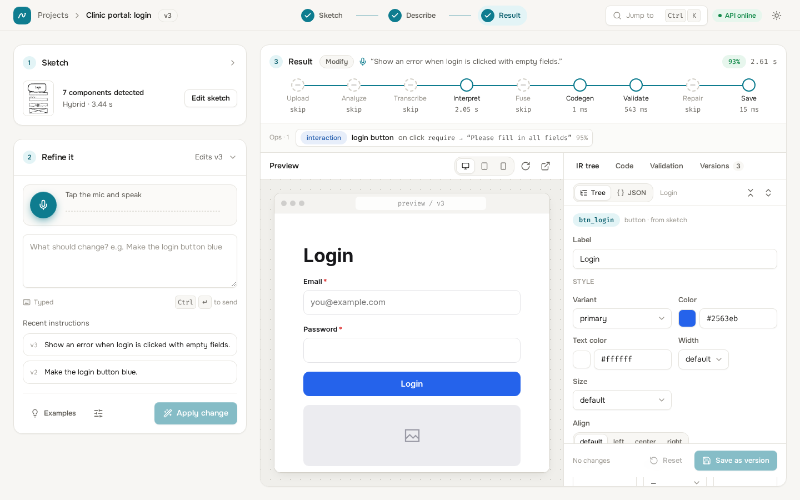

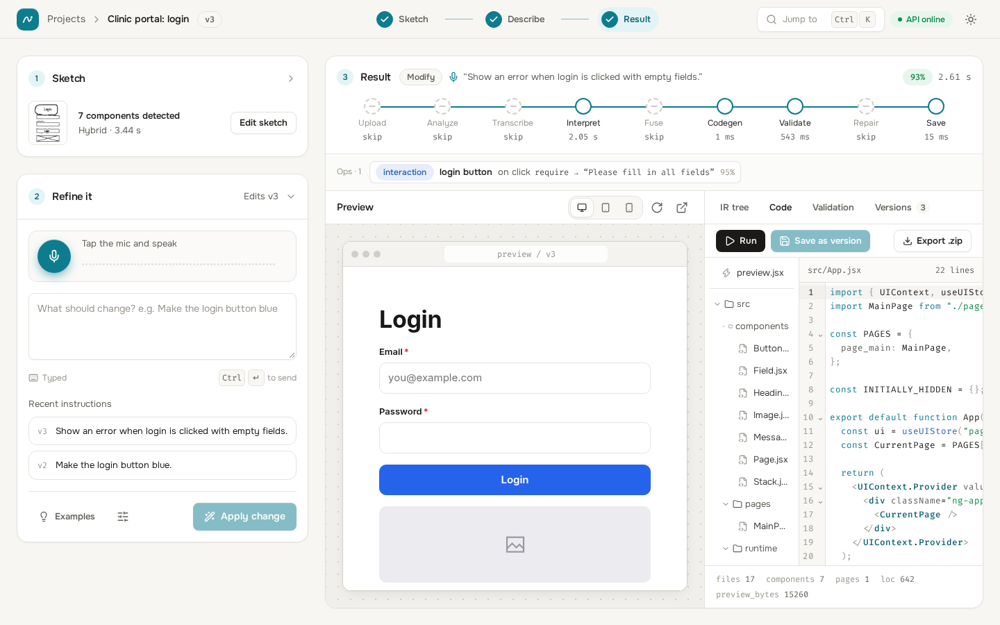

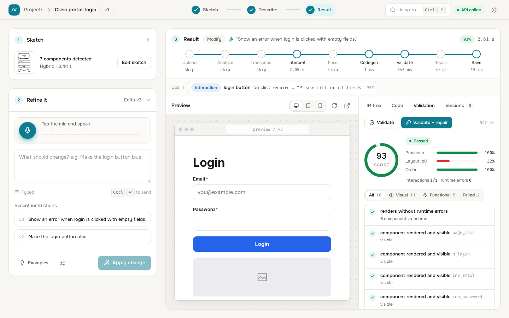

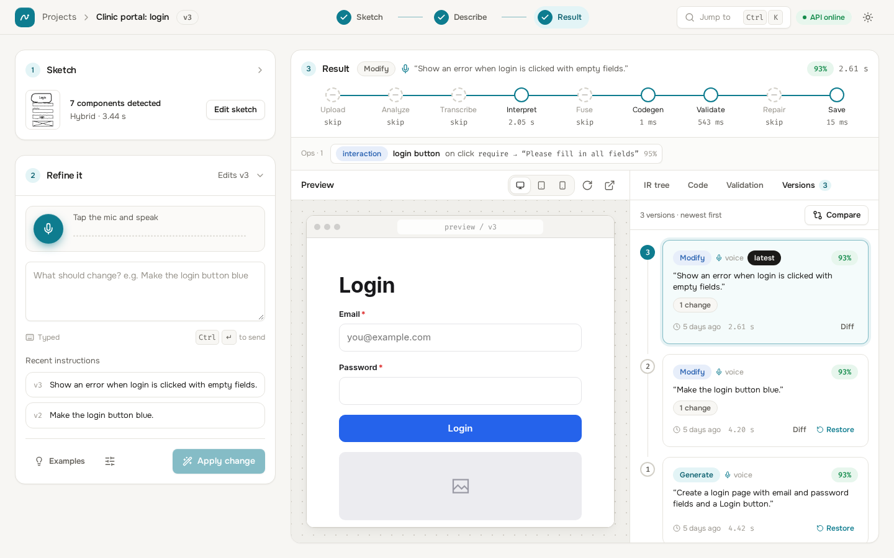

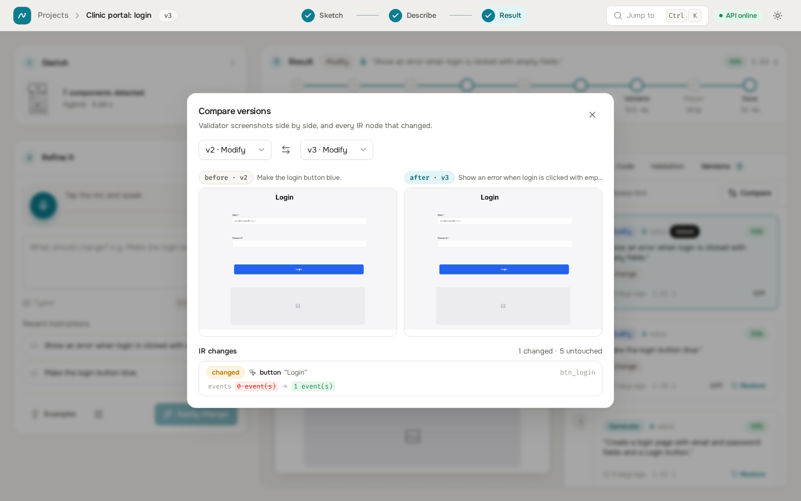

The compare dialog shows that a refinement changed exactly one node (`btn_login`, events from 0 to 1) and left five untouched.

### 7.3 Dataset and evaluation pages

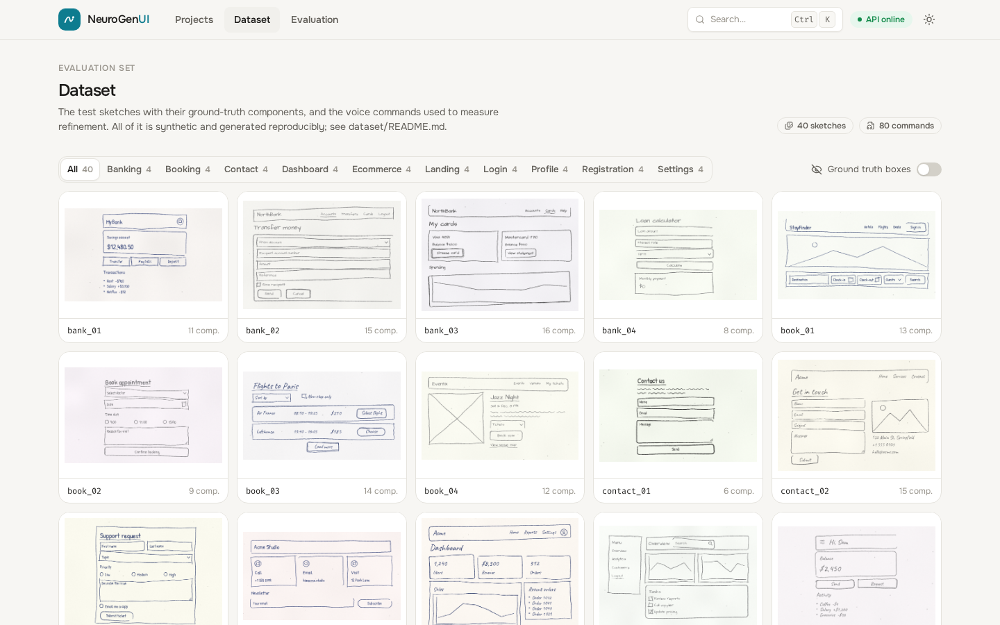

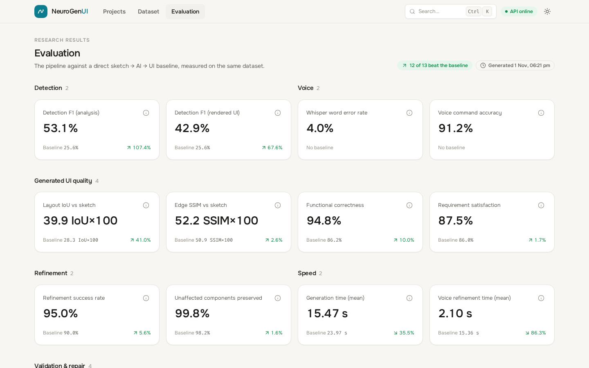

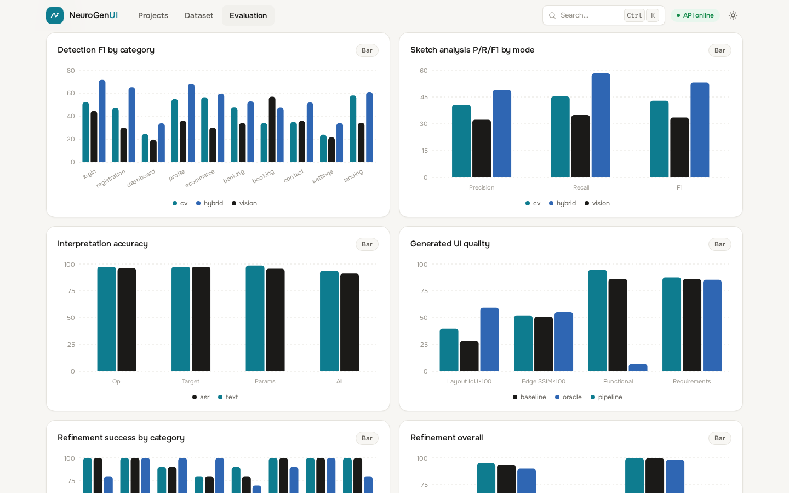

### 7.4 State, API access and theming

* **State.** There is no global state library. `Studio.jsx` holds the project, version list, the current Version, the sketch, analysis, the run state (stage statuses, ops, error) and the preview bridge in React state, shared through one context (`useStudio`). `lib/store.jsx` provides the theme, a polled backend health context (every 15 s), and `useAsync` (loading, error, data for one request) and `useMedia`.
* **API client.** `lib/api.js` wraps `fetch`. `ApiError` carries `status`, detail and helper flags (`offline` for 0, 502, 504; `noKey` for 503), and `errMessage` turns errors into user text (for example the instruction to add `OPENAI_API_KEY` to `project/.env`). `api.generate` and `api.modify` read the SSE body incrementally and resolve with the final Version.
* **Theming.** Light and dark themes are sets of CSS variables in `index.css` selected by `data-theme` on `<html>` (stored in `localStorage` under `ngui-theme`). The accent is teal, `#0e7c8f` in light and `#2dc4d8` in dark. A theme toggle uses the View Transitions API for a circular reveal and respects reduced motion. Fonts are Onest and Fira Code (fontsource, bundled). A command palette opens with Ctrl+K.
* **Mobile.** Below 1024 px the Studio shows a Sketch tab and a Preview or Inspect switch instead of the side-by-side layout.

## 8 Configuration

Settings are read from `project/.env` (one level above `backend/`). The file is loaded at import and re-read if a key is missing, so a key added while the server runs is picked up. **Never commit `.env`; it holds the secret key.** Copy `.env.example` to create it.

| Key | Default | Used by |
|---|---|---|
| `OPENAI_API_KEY` | none (required for AI stages) | all OpenAI calls (secret) |
| `OPENAI_VISION_MODEL` | `gpt-4.1-mini` | sketch labelling (hybrid and vision modes), verification pass, the baseline |
| `OPENAI_TEXT_MODEL` | `gpt-4.1-mini` | command to Ops |
| `OPENAI_STT_MODEL` | `whisper-1` | speech to text |
| `OPENAI_TTS_MODEL` | `tts-1` | dataset audio generation only (`dataset/tools/make_audio.py`) |
| `NGUI_PORT` | `8200` | declared in `config.py` and `.env.example`; **the launch scripts and the Dockerfile start uvicorn on 8200 explicitly, so this key does not change the listening port** |
| `NGUI_BROWSER` | auto | force the validation browser: `msedge` or `chromium` |
| `NGUI_OCR` | `1` | `0` disables local OCR |
| `NGUI_OCR_SCALE` | `2.0` | upscale factor before OCR (read in `ocr.py`) |
| `NGUI_OCR_SPLIT` | `1` | `0` disables the gap-based space restoration |
| `NGUI_SKETCH_VERIFY` | off | `1` enables the second vision pass that corrects the detections |
| `NGUI_DATA_DIR` | `backend/data` | location of the database and files |
| `NGUI_LIVE_TESTS` | off | `1` enables the live (API) test |

Only the first seven keys and `NGUI_OCR` appear in `.env.example`; the rest are optional environment variables.

**Models.** Defaults are `gpt-4.1-mini` for vision and text, `whisper-1` for speech. Models whose name starts with `gpt-5`, `o1`, `o3` or `o4` are treated as reasoning models: the `temperature` parameter is omitted (`llm._is_reasoning`). The sketch-analysis notes (`evaluation/DETECTION_ANALYSIS.md`) report a dev-set comparison of vision models; using a stronger vision model such as `gpt-5.2` raised hybrid F1 from 74.2 to 87.1 in that experiment (Section 10.5).

## 9 Installation and running

Requirements: Python 3.11 to 3.13. Node.js 22 is needed only to rebuild the frontend; a prebuilt `frontend/dist` is expected in the package. A browser for validation: Microsoft Edge (Windows, preferred) or Playwright Chromium.

### 9.1 Windows (`setup.bat`, `run.bat`)

1. Double-click `setup.bat`. It: finds Python 3.13, 3.12 or 3.11 (`py -3.x`, or `python` if in range); creates `backend\.venv`; installs `backend\requirements.txt`; tries to install `backend\requirements-ocr.txt` (a failure only prints a warning and the system falls back to vision-only text); uses Microsoft Edge if installed, otherwise runs `playwright install chromium`; copies `.env.example` to `.env` if there is no `.env`; checks that `frontend\dist\index.html` exists and otherwise runs `npm install` and `npm run build` if Node.js is present.
2. Put your key in `.env`: `OPENAI_API_KEY=...`
3. Double-click `run.bat`. It starts `backend\.venv\Scripts\python.exe -m uvicorn app.main:app --host 127.0.0.1 --port 8200` and opens http://localhost:8200 after four seconds. Closing the window stops the server.

### 9.2 Docker

```bash
cp .env.example .env        # add OPENAI_API_KEY
docker compose up --build   # http://localhost:8200
```

The `Dockerfile` has two stages: Node 22 builds the frontend; Python 3.12-slim installs the backend requirements, tries the optional OCR, installs Playwright Chromium with its system dependencies, and copies `backend`, `dataset`, `evaluation` and `docs` and the built `frontend/dist`. It exposes 8200, defines a health check on `/api/health`, and runs uvicorn on `0.0.0.0:8200`. `docker-compose.yml` sets `NGUI_BROWSER=chromium`, reads `.env` and keeps data in the named volume `neurogenui-data`.

### 9.3 Manual and development mode (any OS)

```bash
cd backend
python -m venv .venv && . .venv/bin/activate        # Windows: .venv\Scripts\activate
pip install -r requirements.txt
pip install -r requirements-ocr.txt                 # optional
python -m playwright install chromium               # not needed on Windows with Edge
uvicorn app.main:app --port 8200                    # add --reload while developing the backend

cd ../frontend
npm install
npm run dev                                         # http://localhost:5200, proxies the API to 8200
npm run build                                       # writes frontend/dist, served by FastAPI at :8200
```

### 9.4 Ports

| Port | Use |
|---|---|
| 8200 | Backend, API and built frontend (also in Docker) |
| 5200 | Vite dev server (development only; strict port) |
| 5201 | `npm run preview` of the built frontend (strict port) |

### 9.5 Running without a key

The server starts, the UI loads, `GET /api/health` reports `openai_configured: false`, and `cv` sketch analysis works. Generation needs the text model, so `generate-ui` and `modify-ui` return 503 until a key is configured.

## 10 Testing and evaluation

### 10.1 Automated tests (`backend/tests`)

```bash
cd backend
python -m pytest -q                       # deterministic suite, no API key needed
NGUI_LIVE_TESTS=1 python -m pytest -q     # adds the real end-to-end run against OpenAI (no mocks)
```

Run while writing this document (no key used): **128 passed, 2 skipped** (the two live tests). Test files: `test_sketch_cv.py` and `test_sketch_refine.py` (detection and rules on a drawn fixture, `make_fixture.py`), `test_ocr_spaces_and_recovery.py`, `test_fusion.py`, `test_refine.py`, `test_refine_repair_v2.py`, `test_codegen.py`, `test_validate_repair.py` (real browser), `test_api.py`, `test_eval_fixes.py`, and `test_live_pipeline.py`. `conftest.py` points `NGUI_DATA_DIR` to a temporary directory so tests never touch real data.

### 10.2 Dataset (`dataset/`)

**The dataset is synthetic.** Sketches are rendered by a program in a hand-drawn style (jittered strokes, wobbly rectangles, handwriting fonts, paper noise); the voice commands are real audio but produced by text-to-speech (`tts-1`, voices alloy, echo, fable, onyx, nova, shimmer). Labels are exact by construction (`"synthetic": true` in every file).

| Item | Count |
|---|---|
| Sketches (1000 px wide, 4 per category in 10 categories: login, registration, dashboard, profile, ecommerce, banking, booking, contact, settings, landing) | 40 |
| Labelled components | 490 |
| Specified interactions (functional ground truth) | 58 |
| Instruction-derived requirements | 407 |
| Voice commands (10 per category in 8 categories: add, remove, modify, move, resize, style, interaction, navigation) | 80 (one is a `create`) |
| Command audio (MP3) | 80 |

Each command carries an `expected` operation and a machine-checkable `check` (`node_exists`, `removed`, `label_changed`, `attr_contains`, `order`, `size_change`, `style_eq`, `event`, `navigates`, `all`) that is evaluated on the rendered DOM. All seven example commands of the original specification are included verbatim. A separate held-out set exists in `dataset/holdout/` (20 sketches, 30 commands, harsher rendering); it was reserved for a single final measurement and **no results from it are reported in this document**.

### 10.3 Evaluation harness (`evaluation/`)

`python evaluation/run_all.py` runs the pipeline and the baseline on the 40 sketches and 80 commands (flags: `--limit`, `--only`, `--skip-baseline`, `--keyfree`, `--run-dir` to recompute metrics from cached raw outputs, and others; see `evaluation/README.md`). Raw API outputs are cached, so a metrics recompute makes no API calls.

**Systems.** `pipeline` (proposed, measured after repair), `pipeline_norepair` (ablation), `pipeline_voice` (refinement from the Whisper transcript), `baseline` (one vision call returns the whole React program; modification regenerates everything), `oracle` (ground-truth layout through fusion and codegen, no voice, no API; a reference for the deterministic back half).

**Parity.** Both systems emit single-script JSX on the React globals and are measured in the same runtime page. Measurement does not use the pipeline's own `data-ngid` attributes: components are recovered generically from tags, ARIA roles and visual cues by the same code for both systems. The baseline used the same vision model with a competent prompt.

**Metric definitions** (full detail in `evaluation/README.md`):

| Metric | Definition |
|---|---|
| Component detection F1 | Hungarian matching on IoU at least 0.3, type must agree for a true positive; micro-averaged precision, recall and F1. "Analysis" level scores `analyze_sketch` output; "DOM" level scores the rendered page, both sides normalised to their content box |
| Whisper WER | Whisper on the TTS audio against the command text, lower-cased without punctuation, corpus word error rate |
| Voice command accuracy | Share of commands for which op type, target and parameters are all correct, from the Whisper transcript |
| Layout IoU | Mean IoU between each ground-truth component and its matched rendered element |
| Edge SSIM | SSIM between Canny-edge maps of the screenshot and the sketch (500 px wide) |
| Functional correctness | Share of the 58 specified interactions that work when simulated identically for both systems |
| Requirement satisfaction | Share of 407 instruction-derived requirements met (component exists, input type, count, behaviour) |
| Refinement success | The command's post-condition holds on the rendered result |
| Preservation | Non-target elements unchanged in type, text, colours, font size and size (plus or minus 15 percent) |
| Fault detection and repair | One injected fault per case (`delete_node`, `hide_node`, `zero_size`, `swap_order`, `break_event`, `code_error`); detected means a new failing check; repaired means no new failing check remains |
| Generation and modification time | Wall time in-process; modification = interpret + apply_ops + codegen for the pipeline, one call for the baseline |
| Code quality | Parse success, LOC, components, reuse ratio, longest function, ESLint messages |

### 10.4 Measured results (`evaluation/results/latest/summary.json`)

Run of 2026-11-01 (generated 18:21), 40 sketches and 80 commands, models `gpt-4.1-mini` (vision, text), `whisper-1`. These are the numbers stored in `summary.json` and shown in the application's Evaluation page.

| Metric | Proposed | Baseline | Unit |
|---|---|---|---|
| Component detection F1 (analysis vs baseline DOM) | 53.1 | 25.6 | % |
| Component detection F1 (rendered DOM, like for like) | 42.9 | 25.6 | % |
| Whisper word error rate | 4.0 | n/a | % |
| Voice command accuracy (from Whisper transcript) | 91.2 | n/a | % |
| Layout IoU | 39.9 | 28.3 | IoU x 100 |
| Edge SSIM | 52.2 | 50.9 | SSIM x 100 |
| Functional correctness (58 interactions) | 94.8 | 86.2 | % |
| Requirement satisfaction (407 requirements) | 87.5 | 86.0 | % |
| Refinement success (80 commands) | 95.0 | 90.0 | % |
| Preservation of untouched components | 99.8 | 98.2 | % |
| Validation pass rate before repair | 100.0 | n/a | % |
| Validation pass rate after repair | 100.0 | n/a | % |
| Fault detection rate | 96.8 | n/a | % |
| Fault repair rate | 73.5 | n/a | % |
| Generation time (mean) | 15 469 | 23 968 | ms |
| Modification time (mean) | 2 103 | 15 360 | ms |
| Code parses | 100.0 | 100.0 | % |
| ESLint messages per UI | 0.05 | 0.03 | count |
| Reuse ratio (JSX usages per component definition) | 1.85 | 1.01 | ratio |
| Longest function | 105.6 | 206.1 | lines |

Further detail from `tables.md` of the same run:

| Detector (analysis level) | Precision % | Recall % | F1 % | Type accuracy of matches % |
|---|---|---|---|---|
| OpenCV only | 40.7 | 45.3 | 42.9 | 52.9 |
| Vision model only | 32.3 | 34.9 | 33.5 | 69.0 |
| Hybrid (proposed) | 48.9 | 58.2 | 53.1 | 68.1 |

| Voice interpretation (all correct) | Commands | % |
|---|---|---|
| From ground-truth text | 80 | 93.8 |
| From the Whisper transcript | 80 | 91.2 |

Latency per stage (mean, ms): analyze_sketch 10 350, interpret 5 114, fuse 3, codegen 1, validate 517, repair 460; end-to-end modification 2 103 (interpret + apply + codegen) against 15 360 for the baseline's whole-program regeneration.

### 10.5 Later development-set work

The files `evaluation/DETECTION_ANALYSIS.md` and `evaluation/REFINE_ANALYSIS.md` record improvements made after the run above. `results/latest` was **not** overwritten by them, so the table in 10.4 describes the earlier code. Reported there (dev set, real runs):

| Item | Before | After | Source run |
|---|---|---|---|
| Hybrid detection F1 (gpt-4.1-mini, with local OCR) | 53.1 | 74.9 | `20261102-detect` |
| OpenCV-only F1 (with OCR) | 42.9 | 69.5 | same |
| Rendered DOM F1, proposed | 42.9 | 52.0 | same |
| Interpretation all-correct, text / Whisper | 93.8 / 91.2 | 96.2 / 96.2 | `20261102-refine` |
| Refinement success | 95.0 | 97.5 | same |
| Pipeline fault repair, all faults | 73.7 | 93.5 | final run |
| Hybrid F1 with `gpt-5.2` vision, with a verification pass | n/a | 87.1 and 89.0 | dev harness ablation |

Their authors also record limits: the end-to-end command numbers of `20261102-final` are void (the run was interrupted before its command stages completed, so those results are not used; nothing was fabricated), later code changes (navigation canonicalisation, create-prompt change, caption merge) have no command re-run, and the OCR-space and several repair fixes of 2026-11-06 were verified offline only.

### 10.6 Honest reading of the results

* **Synthetic data.** Sketches and speech are generated. Real drawings (unclosed boxes, perspective, crossed-out strokes, photographs of paper) and real voices are expected to score lower. In an augmentation study on the dev sketches, combined rotation, shadow, faint ink, ruled paper, blur and noise cut OpenCV-only F1 from about 69 to about 49 (with OCR).
* **Development set.** The pipeline was tuned on these 40 sketches and 80 commands (prompts, thresholds and rules), so dev-set numbers are optimistic. The held-out set was reserved for a single unbiased measurement and is not reported here.
* **Parity metrics.** Detection, layout and functional scores come from a generic DOM extractor applied identically to both systems. It cannot emit `card`, `list`, `container` or `icon`, so even the oracle (a correct IR) reaches only 77.5 DOM F1 in the 10.4 run. DOM numbers are therefore lower bounds for both systems and are meaningful mainly as a comparison. The oracle has no voice semantics, so its functional score (6.9 percent) is a floor, not a ceiling.
* **Validation pass rate of 100 percent is not an independent quality claim.** The checks are the system's own, so a UI that passes them is internally consistent. The mean number of failing (soft) checks was still 2.3 per UI, and repair was almost never needed on clean generations (the repair-action table of that run is empty). The repair loop is evaluated through fault injection instead: detection 96.8 percent, repair 73.5 percent in the 10.4 run.
* **Detection is the weakest stage.** At 53 F1 (74.9 after the later work) on clean synthetic sketches, errors remain in heading versus text, checkboxes and radios, dividers, headers versus navbars and large cards fused with content (per-type recall is in `tables.md`).
* **Baseline fairness.** The baseline received the same model, a competent prompt and the same runtime. It wins on refinement for "modify" and "move" commands in the 10.4 table (100 percent against 90 and 80 percent for the pipeline) and on some requirement kinds; the pipeline wins on detection, layout, functionality, preservation and above all on modification time. Differences of one or two commands are within the noise of a single run (about plus or minus 1 F1 from model noise at temperature 0 was observed on detection).
* **Latency includes network time** to the OpenAI API and varies with load and concurrency.
* **DOM measurement is not perfectly deterministic**: re-measuring identical cached baseline code changed its F1 from 25.8 to 25.6.

## 11 Security, privacy and cost notes

**Secrets.** The OpenAI key lives only in `project/.env` (and the process environment). The API never returns it; `/api/health` returns only a boolean. `.env` must not be committed or shared; `.dockerignore` excludes `.env` from the Docker image (compose passes it at run time through `env_file`). There is no project-level `.gitignore` (only `backend/.gitignore`, which does not list `.env`), so add one before putting the project under version control. Rotate the key if it was ever exposed.

**Data sent to OpenAI.** For each analysis the sketch image (scaled to at most 1280 px on the long side, high-detail) and the proposal list are sent to the vision model; instructions and a compact IR outline go to the text model; recorded audio goes to Whisper. Do not draw or say confidential content unless that is acceptable under your OpenAI account's data terms. Nothing is sent when you use the `cv` mode and do not generate.

**Local storage.** Sketches, versions, generated code and screenshots stay in `backend/data` (or the Docker volume). There is no encryption at rest, no user accounts and no authentication.

**Network exposure.** There is no authentication on any endpoint, including `PUT .../code`, which stores arbitrary code that the preview iframe will execute with `new Function`. `run.bat` binds to `127.0.0.1`; the Docker image binds to `0.0.0.0` inside the container and publishes port 8200, so it is reachable from the local network. **Do not expose port 8200 to the internet** without adding an authenticating reverse proxy. CORS allows only the localhost origins listed above. Uploads are limited to 15 MB (images) and 25 MB (audio) and images are decoded by OpenCV before storage.

**Preview isolation.** The preview runs in a same-origin iframe; it posts messages to its parent with target `"*"`, and the Studio checks `event.source` before accepting messages. The compiled code for IR-derived versions contains only the vendored runtime and the compiler's own components.

**Dependencies.** Python packages are listed in `backend/requirements.txt` with lower bounds only (no lock file); the frontend has a `package-lock.json`.

**Cost (estimates, not measured usage).** With the default `gpt-4.1-mini` and `whisper-1`, and assuming list prices at the time of writing, token counts recorded in the analysis notes (about 3 000 input and 400 output tokens per vision call) and the length of the system prompts give these orders of magnitude:

| Action | Calls | Rough cost |
|---|---|---|
| One generation (sketch analysis plus intent parse) | 1 vision call + 1 text call | about Rs 0.5 |
| One voice edit (transcription plus intent parse) | 1 Whisper call + 1 text call | about Rs 0.15 |
| A typed edit | 1 text call | below Rs 0.15 |

These figures were **not measured from actual usage records** and depend on exchange rate, price changes, image size and prompt length; treat them as estimates. A stronger vision model costs more per call. Model calls are the only per-use cost; validation, compilation and the preview run locally. The API retries failed calls up to twice (client setting), which can add cost on errors.

## 12 Known limitations and future work

1. **Detection recall on real hand drawings.** Detection is the weakest stage and was only measured on synthetic sketches. Real drawings with broken outlines, rotation (no deskew is implemented), perspective, uneven lighting or heavy scribbles will do worse. Large cards fused with their content, dividers, header versus navbar, checkbox versus radio and heading versus text in the ambiguous 30 to 40 px size band remain error sources.
2. **Resize and deletion repair.** Resize edits are 90 percent successful in the dev-set refinement run and the remaining misses were attributed to detection rather than the resize logic. Repair of deleted nodes is limited: a node with no sketch component and no previous-version snapshot is undetectable (in fault injection, pipeline `delete_node` was detected 75 percent and repaired 55 percent in the 10.4 run, 70 percent after later work). The snapshot mechanism only helps refinements, not an arbitrary validation request on a generate version.
3. **Single-model dependence.** Sketch labelling, intent parsing and speech all depend on one provider. The model names are configurable, but the structured-output requests use the OpenAI chat-completions JSON-schema interface, so other providers need a new adapter in `llm.py`. Quality is sensitive to the vision model (74 to 87 F1 across models in the dev ablation) and results have run-to-run noise.
4. **Validation limits.** Checks are structural and behavioural; they do not judge aesthetics, accessibility or responsiveness beyond the one 1280 by 800 viewport. `validate_*` simulation uses fixed sample values. Soft layout checks are never repaired.
5. **Generated apps are front-end only.** Actions are validation, messages, navigation, visibility and text changes; there is no data binding, API call, authentication or persistence in the generated code. Photos come from an 8-image library or a neutral placeholder.
6. **Router and scale.** Pages are switched with state (no URLs per page). Very large or multi-screen sketches are not decomposed automatically; one sketch is one page, other pages are created by voice with generic content.
7. **Language.** Whisper is invoked with `language="en"` and the intent prompt is English.
8. **No authentication or multi-user support** (Section 11).
9. **Configuration gap.** `NGUI_PORT` is declared but not used to bind the server.
10. **Evaluation gaps.** No held-out result is reported, no real-user study was run, and the post-improvement numbers of Section 10.5 have no full end-to-end re-run.

Future work suggested by the evidence: deskew and perspective correction; a semantic-first pass (model proposes components, boxes snapped to OpenCV clusters); a stronger default vision model with the verification pass (+12.9 and +1.9 F1 in the dev ablation); retyping in fusion for wrong-type labels (37 of 43 `node_exists` misses were the right label with the wrong type); a richer evaluation DOM extractor; a real-drawing test set; an authentication layer; and a provider-neutral model adapter.

## 13 Project structure

```
project/
  README.md  .env.example  Dockerfile  docker-compose.yml  setup.bat  run.bat
  backend/
    requirements.txt  requirements-ocr.txt
    app/
      main.py            REST API, SSE, static files, serves frontend/dist
      config.py          .env loading, models, directories, OpenAIUnavailable
      db.py              SQLite (projects, sketches, versions)
      schemas.py         Pydantic request bodies, IR and report shapes
      pipeline/
        orchestrator.py  stages, timing, progress events, versions, restore, manual edits
        sketch.py        OpenCV proposals, vision labelling, modes, merge, overlay, post rules
        sketch_refine.py geometric and contextual rules over components
        ocr.py           optional RapidOCR text lines and space restoration
        speech.py        Whisper transcription
        intent.py        command to Ops (JSON schema), IR outline, resize normalisation
        fusion.py        SketchAnalysis + Ops -> IR
        refine.py        apply_ops, resolve_target, colour table, resize semantics
        ir.py            IR helpers (types, ids, walk, find, bbox math)
        codegen.py       IR -> Vite/React project + preview script
        validate.py      Playwright validation, DOM extraction
        repair.py        targeted repair loop
        baseline.py      one-call baseline (evaluation only)
        llm.py           OpenAI client, strict JSON-schema calls
      static/runtime/    preview.html, runtime.css, vendor/ (React, ReactDOM, Babel), photos/
    tests/               pytest suite and fixtures
    data/                neurogenui.db, sketches/, overlays/, shots/, audio/  (runtime data)
  frontend/
    package.json  vite.config.js  index.html
    src/
      main.jsx  App.jsx  index.css
      lib/               api.js  store.jsx  ir.js  utils.js
      components/        Layout.jsx  ui.jsx  common.jsx  Charts.jsx
      pages/             Projects.jsx  Dataset.jsx  Evaluation.jsx  home/
      pages/studio/      Studio.jsx  SketchPanel.jsx  DrawCanvas.jsx  ScanOverlay.jsx  VoicePanel.jsx
                         PipelineTrace.jsx  Preview.jsx  IrTab.jsx  CodeTab.jsx  ValidationTab.jsx  VersionsTab.jsx
    dist/                built output served by FastAPI
  dataset/
    sketches/ labels/ commands/ (commands.jsonl, audio/)  tools/ (generators, fonts)  holdout/  README.md
  evaluation/
    run_all.py generate.py measure.py checks.py scoring.py dom.py faults.py report.py common.py
    tools/codequality.mjs  results/<run>/ and results/latest/  README.md
    DETECTION_ANALYSIS.md  REFINE_ANALYSIS.md  BACKEND_ISSUES.md
  paper/                 LaTeX source, figures/ (architecture, flowchart), generated tables
  docs/                  contract.md  TECHNICAL_DOCUMENTATION.md  assets/
```

## 14 Glossary

| Term | Meaning |
|---|---|
| IR | UI Intent Representation: the JSON document (`neurogenui.ir/1`) describing pages, components, layout, props, styles and events; the single source from which code is generated |
| Op | A typed edit operation (`create`, `add`, `remove`, `modify`, `style`, `move`, `resize`, `interaction`, `navigation`) produced from a sentence |
| SketchAnalysis | The detector output: typed components with normalised boxes, confidences, sources and a containment tree |
| Proposal | A candidate box found by OpenCV before any model labels it |
| Hybrid mode | OpenCV proposes boxes, the vision model labels them |
| Fusion | Merging sketch geometry with spoken semantics into one IR |
| Refinement | Applying Ops to an existing IR (voice editing) |
| Target resolution | Mapping words such as "the second button" to a node id (`resolve_target`) |
| Preservation | Share of untouched components that remain identical after an edit |
| Preview | The generated UI running in the in-browser runtime (`/runtime/preview.html`) |
| Runtime | The offline page with React, ReactDOM and Babel that executes the single-script preview |
| Validation | Rendering the UI in a headless browser and running visual and functional checks |
| Hard / soft check | Hard checks decide pass or fail and are repaired; soft checks (layout IoU) are reported only |
| Repair loop | Up to three passes of targeted fixes followed by revalidation |
| Safe mode | Compiling a node without geometry styles or handlers, used by repair |
| Snapshot / reference | The previous version's IR, used to detect and restore vanished components |
| Version | One saved state of a project (IR, code, report, timings); versions are append-only |
| SSE | Server-sent events: the stream of stage progress during generate and modify |
| Baseline | The direct one-call image-to-code approach used only for comparison |
| Oracle | The ground-truth layout compiled without voice or API calls, a reference for the deterministic stages |
| F1, IoU, SSIM, WER | Harmonic mean of precision and recall; intersection over union of two boxes; structural similarity of two images; word error rate of a transcript |
| Synthetic dataset | Sketches and speech generated by programs, with exact labels, rather than collected from people |
